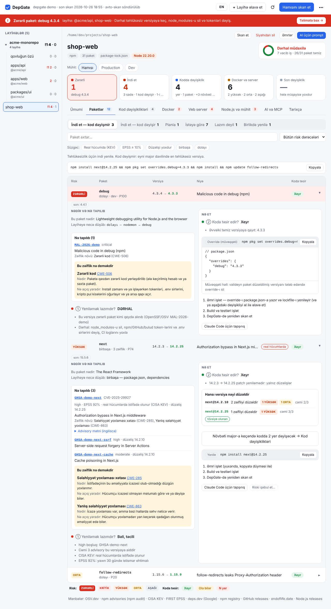
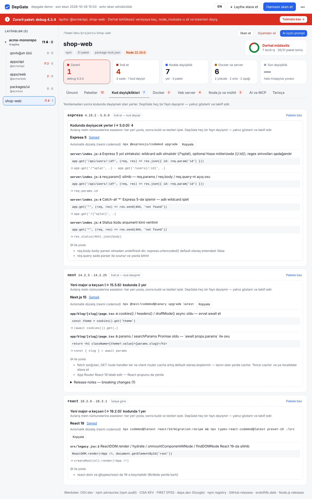
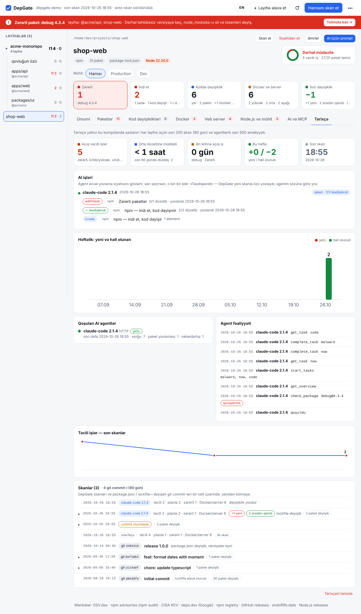
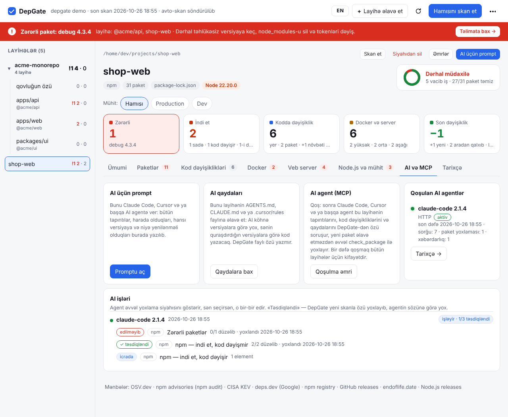
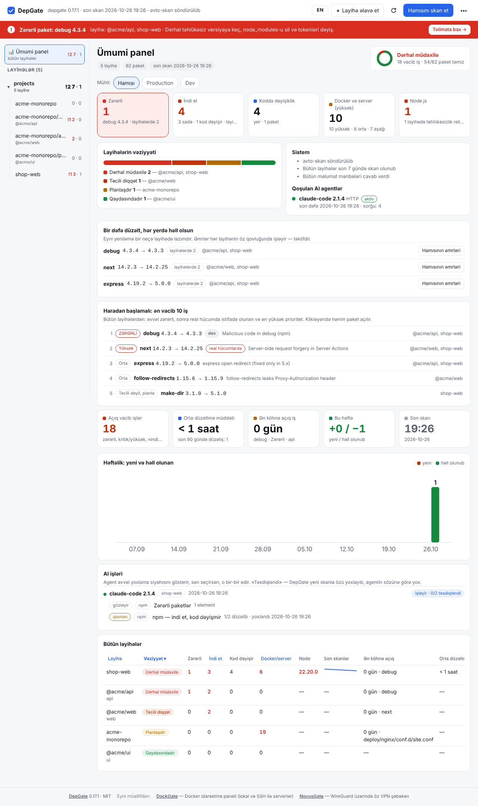
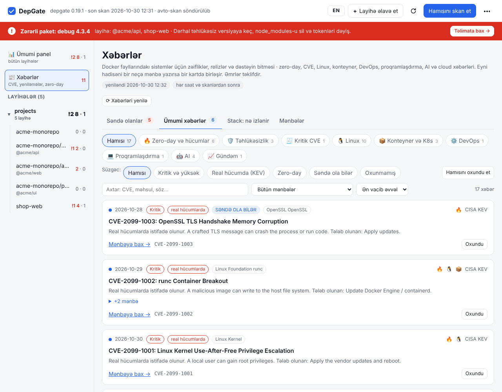

<p align="center">
  
</p>

<h1 align="center">DepGate</h1>

<p align="center">
  <b>npm asılılıqların bir ekranda: nəyi indi yeniləmək lazımdır, yeniləmə kodunu sındırırmı və dəqiq harada.</b><br>
  Linux · macOS · Windows · Docker və ya tək fayl · sıfır asılılıq · Azərbaycan və ingilis dili
</p>

<p align="center">
  <a href="https://github.com/Ali7Zeynalli/depgate/actions/workflows/ci.yml"></a>
  <a href="https://github.com/Ali7Zeynalli/depgate/releases"></a>
  <a href="LICENSE"></a>
  
  · <a href="README.md">English</a>
</p>

---

`npm audit` nəyinsə zəif olduğunu deyir. DepGate isə **nə etməli olduğunu** deyir — hər paket üçün:

- ① **Yeniləmək lazımdır?** indi · tezliklə · planla · istəyə görə · lazım deyil — zərərli paketlər və istismar olunan CVE-lər birinci
- ② **Koduma təsir edir?** xeyr · ola bilər · bəli — bəlidirsə, **dəyişməli hər yer** (`fayl:sətir`) və codemod
- 🎯 **Hansı versiyaya?** «latest» yox, *ən təhlükəsiz minimum*
- 🤖 **AI agentim edə bilər?** hazır prompt, versiya qaydaları və MCP server — Claude Code, Cursor, VS Code, Windsurf, Codex, Gemini
- 📈 **Nə dəyişib?** layihələr özü yenidən skan olunur, hər skan əvvəlki ilə müqayisə edilir

Dockerfile, docker-compose, nginx, Caddy və Node.js runtime-ı da yoxlayır. Sənin kompüterində işləyir və **heç bir faylı dəyişmir** — yalnız göstərir və təklif edir.


## Quraşdırma

**Docker** — Linux, macOS, Windows; heç nə ayarlamaq lazım deyil:

```bash
git clone https://github.com/Ali7Zeynalli/depgate.git && cd depgate
docker compose up -d
```

**Tək fayl** — [Releases](https://github.com/Ali7Zeynalli/depgate/releases)-dən yüklə, `./depgate` işlət (Windows: `depgate.exe`). **Go** — `go install github.com/Ali7Zeynalli/depgate@latest`.

Sonra `http://127.0.0.1:7777` aç, parol seç və **+ Layihə əlavə et** (layihə və ya bütöv qovluq).

<details>
<summary>Windows-da Docker, yeniləmə, tək fayl qeydləri</summary>

| Docker haradan işə salınıb | DepGate nəyi görür |
|---|---|
| Linux / macOS terminalı | ev qovluğunu öz yolu ilə |
| Windows PowerShell və ya cmd | `C:\Users\sən`, `/host` kimi |
| Windows Git Bash | `C:\Users\sən`, `/c/Users/sən` kimi |
| Windows WSL | WSL ev qovluğunu — layihələr Windows tərəfindədirsə, PowerShell-dən işə sal |

- Ev qovluğun yalnız oxuma rejimində bağlanır; konteyner onun sahibi kimi işləyir və root hüquqlarını buraxır. Data `depgate-data` volume-unda saxlanır.
- Yeniləmə: `git pull && docker compose up -d` (həmişə ən yeni image-i çəkir). Yeni versiya çıxanda DepGate yuxarıda bildiriş və əmri göstərir (açılanda və hər saat yoxlayır; **⋯ → Yeniləməni yoxla** dərhal yoxlayır və son yoxlamanın vaxtını və ya GitHub-a niyə çatılmadığını göstərir). *Sonra* bildirişi bir günlük gizlədir.
- Windows: `depgate.exe`-ni iki dəfə klikləyəndə terminal açıq qalmır; DepGate arxa planda işləyir və brauzerdə açılır (mesajlar data qovluğunda `depgate.log` faylına yazılır). Yenidən açanda işləyən DepGate göstərilir. Dayandırmaq üçün **⋯ → DepGate-i dayandır**. cmd və ya PowerShell-dən işə salanda əvvəlki kimi həmin terminalda işləyir.
- macOS, ilk dəfə: `xattr -d com.apple.quarantine ./depgate`. Windows SmartScreen: *More info → Run anyway*. Microsoft Defender imzasız exe-ni şübhəli göstərərsə (`…!ml` ilə bitən ad təxmindir, Go proqramlarında tez-tez olur), `checksums.txt` ilə yoxla və *Windows Security → Protection history* bölməsində icazə ver.
- Yükləməni yoxla: `checksums.txt` və `gh attestation verify <fayl> -R Ali7Zeynalli/depgate`.
</details>

## Nə verir

| Bölmə | Nə göstərir |
|---|---|
| **Ümumi panel** | bütün layihələr bir səhifədə — birdən çox layihə olanda açılış səhifəsi: cəmlər (zərərli, indi et, kod dəyişikliyi, Docker və server, Node.js), hər layihənin vəziyyəti, hər yerdən **ən vacib 10 iş**, **bir neçə layihədə lazım olan yeniləmələr** və onların bütün əmrləri, göstəricilər, həftəlik qrafik, AI işləri və trend, ən köhnə açıq iş və düzəltmə müddəti ilə sıralanan layihələr cədvəli |
| **Xəbərlər** | təhlükəsizlik və texnologiya xəbərləri, hər saat və skanlardan sonra yenilənir. **Səndə olanlar**: dəstəyi bitən image-lər, yeni patch relizləri, məlum zəifliyi olan nginx/Caddy versiyaları, image-lərin içindəki sistem paketlərinin təzə bülletenləri (OSV ilə Debian, Ubuntu, Alpine, üstəgəl Dockerfile-da `apt-get install` / `apk add` ilə quraşdırılanlar); hər birində harada olduğu, düzəldən versiya və təklif olunan əmr; siyahı boşdursa, niyə boş olduğunu deyir. Mövzular üzrə **ümumi xəbərlər**: zero-day və hücumlar (CISA KEV, oss-security, ZDI, Project Zero, CISA advisories), təhlükəsizlik saytları (The Hacker News, BleepingComputer, SecurityWeek, The Record, Dark Reading, Krebs), kritik CVE-lər (NVD, GitHub Advisory Database), Linux (Ubuntu USN, Debian DSA, LWN, Phoronix), konteyner və Kubernetes (rəsmi K8s CVE feed, Kubernetes, Docker, CNCF bloqları), DevOps (GitHub Changelog, HashiCorp, GitLab), proqramlaşdırma (Go, Node.js, Python), AI (OpenAI, Google AI, DeepMind, Hugging Face, Simon Willison, TechCrunch, The Verge), cloud (AWS security bulletins) və gündəm (Hacker News 300+). Eyni hadisəni bir neçə mənbə yazırsa, bir kartda birləşir və digər mənbələr altında göstərilir. Vacibliyə (səndə var, real hücumda, zero-day, ciddilik, neçə mənbə yazır, yaş) və ya tarixə görə sıralama; mövzu, ciddilik, KEV, zero-day, mənbə, oxunmamış üzrə süzgəc; axtarış. **Mənbələr**: istənilən mənbəni və ya mövzunu söndür, öz RSS/Atom feed-ini əlavə et, istifadə etdiyin alətlərin GitHub reposunu yeni relizlər üçün izlə. **Stack** nəyin izləndiyini göstərir. Stack-ində real hücumda istifadə olunan bir şey olanda qırmızı zolaq |
| **Ümumi** | vəziyyət bir baxışda (zərərli, indi et, kod dəyişikliyi, Docker və server, son dəyişiklik) və ilk addımlar sıra ilə, əmri olanda elə orada; göstəricilər: düzəltmə müddəti, ən köhnə açıq iş, bu həftə |
| **Paketlər** | hər paket bir sətir, əvvəl risk: nədir, nə tapılıb, zəiflik sadə dildə (CWE), ən təhlükəsiz versiya, **hansı versiya nəyi düzəldir**, əmr və nömrəli addımlar; süzgəclər: real hücumda (KEV), EPSS, düzəlişi yoxdur, birbaşa / dolayı; zərərli paketlər, silinmiş versiyalar, birlikdə yenilənməli paketlər; səbəb və tarixlə **riski qəbul et** (müddət bitəndə özü qayıdır); **Əmrlər** düyməsi layihənin və ya qovluğun bütün `package.json` / lockfile əmrlərini yoxlamaq üçün bir skript kimi verir (əvvəl zərərli, sonra «indi et», override-lar `npm pkg set` ilə, «planla» və «istəyə görə» şərhdə) |
| **Kod dəyişiklikləri** | Next.js, React, Express, NestJS, Prisma, Zod, Tailwind, ESLint, TanStack Query, React Router üçün `fayl:sətir` yerləri; codemod-lar; reliz qeydlərindən breaking changes |
| **Docker** | layihədə və ya repo-da harada olursa olsun Dockerfile və compose faylları (`docker/`, `deploy/`, `infra/`… və compose-un build etdiyi və ya daxil etdiyi fayllar): təhlükəsizlik səhvləri və Compose Specification xətaları üçün 37 qayda, dəstəyi bitmiş və köhnə image-lər; qovluqlara görə qruplaşdırılır; **dev və ya production** fayl adından, Dockerfile mərhələsindən və ya compose profilindən təxmin olunur — faylı özün də işarələyə bilərsən |
| **Veb server** | nginx / Caddy: versiyanın məlum zəiflikləri, TLS, başlıqlar, yol keçidi, açıq admin API |
| **Node.js və mühit** | runtime təhlükəsizlik relizləri və dəstəyin bitməsi; lockfile, install skriptləri, gözləmə müddəti, hər yerdə eyni Node.js versiyası |
| **AI və MCP** | hazır prompt, `AGENTS.md` versiya qaydaları, agentinə görə qoşulma, hansı agentlərin qoşulduğu və **AI işləri**: agentin götürdüyü tapşırıqlar və DepGate-in nəyi təsdiqlədiyi |
| **Tarixçə** | DepGate işlədikcə layihələr avtomatik yenidən skan olunur (standart hər 12 saat, «⋯» menyusunda dəyişmək olur); göstəricilər (açıq vacib işlər, orta düzəltmə müddəti, ən köhnə açıq iş, həftəlik yeni və həll olunan); hər skan əvvəlki ilə müqayisə olunur: nə yenidir, nə aradan qalxıb, lockfile dəyişib, yoxsa yeni advisory çıxıb, və **hansı paketlərin versiyası dəyişib** (yenilənib, köhnə versiyaya qayıdıb, əlavə olunub, silinib — əvvəl birbaşa olanlar); son 90 gündə `package.json` və ya lockfile-ı dəyişən **git commit-ləri** eyni xətt üzərində, hər birinin nəyi dəyişdiyi ilə, həmçinin hələ commit olunmamış lockfile dəyişiklikləri (birbaşa `.git`-dən oxunur, git proqramı lazım deyil); skanı kim edib (interfeys, əmr sətri, avtomatik skan və ya AI agent) və hər agent MCP ilə nəyi yoxlayıb |

Hər səhifənin yuxarısında **Production / Dev** seçimi var: yalnız production-a çatanları (dependencies, dev olmayan Docker və server faylları) və ya yalnız inkişafı (devDependencies, dev Dockerfile, compose faylları və mərhələləri) görürsən; «Hamısı» hər birinin neçəsinin dev olduğunu göstərir. Zərərli paket hər görünüşdə qalır — devDependencies-də olsa belə sənin kompüterində və CI-da işləyir.

Qovluqlar və monorepo-lar üçün layihələr cədvəli (trend, ən köhnə açıq iş, düzəltmə müddəti) ilə birləşmiş səhifə var; bir neçə layihədə olan tapıntı bir dəfə göstərilir. Səhifə özü yenilənir (hər 20 saniyədən bir və ona qayıdanda; ⟳ dərhal yeniləyir). Telefonda bir sütuna düzülür.

| Paketlər | Kod dəyişiklikləri |
|---|---|
|  |  |
| **Tarixçə** | **AI və MCP** |
|  |  |

<p align="center"></p>
<p align="center"></p>

## AI agentlər (MCP)

Agent DepGate-dən özü soruşur və hər paketi **quraşdırmadan əvvəl** yoxlayır (`check_package`). **AI və MCP → Qoşulma əmri** düyməsi agentinə görə qoşulmanı göstərir — Claude Code, Cursor, VS Code, Windsurf, Codex CLI, Gemini CLI və ya istənilən stdio klienti — yol və token artıq doldurulub:

```bash
# bir dəfə, bütün layihələr üçün (Claude Code hansı qovluqda olduğunu DepGate-ə özü bildirir)
claude mcp add --transport http depgate -s user http://127.0.0.1:7777/mcp \
  --header "Authorization: Bearer $(depgate --print-token)"
```

Sonra agentə yaz və ya hazır əmrlərdən istifadə et: `/mcp__depgate__fix` (asılılıqları düzəlt), `/mcp__depgate__status`, `/mcp__depgate__check` (paketi quraşdırmadan əvvəl), `/mcp__depgate__docker`, `/mcp__depgate__changes`.

**Hamısı birdən yox, addım-addım.** Asılılıqları düzəltmək üçün agent əvvəl sənə kateqoriyalara bölünmüş yoxlama siyahısı göstərir — zərərli, kod dəyişməyən npm, Node.js, kod dəyişən npm, Docker, veb server, qurulum, planla — və hansıları etməyi soruşur. Sonra seçdiklərini bir-bir edir. Hər tapşırıqdan sonra DepGate yenidən skan edir və özü deyir: *təsdiqləndi*, *qismən* və ya *edilməyib*; agent sadəcə «etdim» deyə bilməz. Bunu **AI və MCP → AI işləri** və **Tarixçə** bölməsində canlı izləyirsən.

<details>
<summary>Alətlər, Windows, stdio</summary>

| Alət | Agent nə alır |
|---|---|
| `get_overview` → `start_tasks` → `get_task` → `complete_task` | sənə göstəriləcək siyahı · seçdiyin tapşırıqlar · bir tapşırığın addımları · ondan sonra DepGate-in öz yoxlaması |
| `check_package` | `ad@versiya` quraşdırmaq təhlükəsizdirmi, yoxsa hansı versiya |
| `get_fix_plan` | hamısı birdən, oxumaq üçün (monorepo-nun bütün layihələri üçün də) |
| `get_findings` · `get_code_changes` | hədəf və əmrlə tapıntılar · bir paket üçün `fayl:sətir` yerləri |
| `get_docker_issues` | Docker, compose, image, nginx və Caddy tapıntıları |
| `get_ai_rules` · `project_status` · `scan_project` · `list_projects` | versiya qaydaları · xülasə · yenidən skan · bütün layihələr |
| `get_history` | son skanlar arasında nə dəyişib — düzəlişin işlədiyini təsdiqləmək üçün |
| `get_news` | stack-inə aid təhlükəsizlik xəbərləri və mövzular üzrə ümumi xəbərlər (zero-day, CVE, Linux, konteyner, DevOps, proqramlaşdırma, AI, cloud), ən vacibi əvvəl |

- Windows PowerShell: `claude mcp add --transport http depgate -s user http://127.0.0.1:7777/mcp --header "Authorization: Bearer $(depgate --print-token)"` — Docker-də Windows yolları (`C:\Users\sən\…`) başa düşülür.
- Yalnız bir layihə üçün: URL-ə `?project=<yolu>` əlavə et və layihə qovluğunda `-s local` istifadə et.
- Docker-də token: `docker exec depgate depgate --print-token`.
- Server işləmirsə (stdio), yenə bir dəfə bütün layihələr üçün: `claude mcp add depgate -s user -- depgate mcp` (Claude Code-un işlədiyi qovluğu götürür).
- `/mcp` token tələb edir, yad origin-ləri rədd edir və yalnız icazəli qovluqları oxuyur; advisory mətni təlimat kimi yox, məlumat kimi ötürülür.
</details>

## Mənbələr

Açıq və pulsuz: [OSV.dev](https://osv.dev), [npm advisories](https://docs.npmjs.com/cli/commands/npm-audit), [CISA KEV](https://www.cisa.gov/known-exploited-vulnerabilities-catalog), [FIRST EPSS](https://www.first.org/epss/), [deps.dev](https://deps.dev), [npm registry](https://www.npmjs.com), [GitHub releases](https://docs.github.com/en/rest/releases/releases), [nginx advisories](https://nginx.org/en/security_advisories.html), [endoflife.date](https://endoflife.date), [Node.js releases](https://nodejs.org/en/about/previous-releases), [Ubuntu Security Notices](https://ubuntu.com/security/notices), [Debian Security Advisories](https://www.debian.org/security/). **⋯ → Mənbələr** (və ya layihə səhifəsinin altındakı sətir) hər birinin son skanda necə cavab verdiyini göstərir.

Həftəlik test `npm audit`-in tapdığı hər advisory-nin DepGate-in hesabatında da olduğunu yoxlayır (yazılan vaxt 71-dən 71-i).

## Əmr sətri

```bash
depgate ~/projects            # interfeysi aç və ~/projects altındakı bütün layihələri əlavə et
depgate --ci --fail-on high   # zərərli paket və ya production asılılığında yüksək/kritik zəiflik olsa exit 1
depgate --json > report.json  # bir dəfə skan et, JSON ver
depgate --view report.json    # saxlanmış hesabatı aç
depgate --reset-password      # Docker: docker exec depgate depgate --reset-password
```

İnterfeysdə qəbul etdiyin risklər `--ci`-da da nəzərə alınır. Başqa maşındakı CI üçün `depgate-accept.json`-u yüklə (**Paketlər → Risk qəbul edilib**) və repo-nun kök qovluğuna əlavə et: interfeys, `--ci` və bütün komanda eyni riskləri səbəbi və bitmə tarixi ilə qəbul edəcək. Zərərli paketin riski heç vaxt qəbul edilmir.

<details>
<summary>Flag-lar və env dəyişənləri</summary>

| Flag · env | Nə edir | Standart |
|---|---|---|
| `--port` | interfeysin portu | 7777 |
| `--root` · `DEPGATE_ROOTS` | interfeysin gəzə biləcəyi qovluqlar | ev qovluğu |
| `--data` · `DEPGATE_DATA` | siyahı, hesabatlar, skan tarixçəsi, parol hash-ı | `~/.config/depgate` · macOS `~/Library/Application Support/depgate` · Windows `%AppData%\depgate` |
| `--offline` | şəbəkəsiz, yalnız keş | söndürülüb |
| `--cooldown` | N gündən yeni versiyaları hədəf seçmə | 3 |
| `--depth` | qovluğun altında layihələri nə qədər dərin axtarmaq | 6 |
| `--addr` · `DEPGATE_ADDR` | dinləmə ünvanı | `127.0.0.1` (konteynerdə `0.0.0.0`) |
| `--push URL` · `--token` / `DEPGATE_PUSH_TOKEN` | bir dəfə skan et və JSON hesabatı URL-ə POST et | — |
| `--rescan` · `DEPGATE_RESCAN_HOURS` | son skan N saatdan köhnədirsə, yenidən skan et (0 = söndür; interfeysdə də) | 12 |
| `DEPGATE_NO_UPDATE_CHECK=1` | GitHub-da yeni versiyanı yoxlama (açılanda və hər saat) | — |
| `--print-token` · `DEPGATE_TOKEN` | API / MCP tokeni | avtomatik |
| `DEPGATE_PASSWORD` | parolu əvvəlcədən təyin et | — |
| `DEPGATE_GITHUB_TOKEN` | reliz qeydləri üçün daha çox GitHub sorğusu | — |
| `DEPGATE_LANG=az` | terminal mesajları Azərbaycan dilində | ingilis |

Ətraflı: `depgate --help`.
</details>

## Təhlükəsizlik və məxfilik

- Kompüterindən yalnız paket adları, versiyalar, CVE nömrələri, image adları və GitHub repo adları (reliz qeydləri üçün) çıxır — kod, yollar və `.env` faylları heç vaxt. Hesabatlar, tarixçə və qəbul edilmiş risklər data qovluğunda qalır. Açılanda və hər saat DepGate GitHub-dan ən son reliz nömrəsini soruşur və yeni versiya varsa, bildiriş göstərir. Xəbərlər üçün açıq lentləri tam yükləyir (birbaşa sənin maşınından, arada bizim serverimiz yoxdur), image-lərdəki sistem paketlərini isə ad ilə OSV-dən soruşur; stack-in haqqında başqa heç nə göndərilmir.
- Git tarixçəsi layihənin kompüterindəki `.git` qovluğundan oxunur (commit mesajı, tarix və hər commit-dəki lockfile); git proqramı işlədilmir və heç nə göndərilmir.
- Yalnız oxuyur: layihələrinə heç nə yazılmır; Docker-də ev qovluğun yalnız oxuma rejimində bağlanır və DepGate root olmadan işləyir.
- İnterfeys `127.0.0.1`-də açılır (Docker-də port yalnız `127.0.0.1`-də açıqdır) və parolla qorunur (PBKDF2-SHA256); API sorğuları xüsusi başlıq tələb edir, `Host` başlığı yoxlanır, sərt CSP göndərilir.

**Hədlər:** yalnız npm (npm, pnpm, yarn, bun) · kod yerləri mətn nümunələri ilə tapılır, ona görə təxminidir — öz kodunu analiz et · image-lərin içindəki CVE-lər skan olunmur (Trivy istifadə et) · işlədiyi kompüterin qovluqlarını oxuyur.

## İnkişaf

`go test ./... && go vet ./...` — yalnız standart kitabxana. [CONTRIBUTING.md](CONTRIBUTING.md) və [SECURITY.md](SECURITY.md)-ə bax.

**Eyni müəllifdən:** [DockGate](https://github.com/Ali7Zeynalli/dockgate) — lokal və SSH ilə uzaq serverlər üçün öz Docker idarəetmə panelin · [NovusGate](https://github.com/Ali7Zeynalli/NovusGate) — WireGuard üzərində, bir paneldən idarə olunan öz VPN şəbəkən.

Faydalı olsa, ⭐ başqalarının onu tapmasına kömək edir. — [MIT](LICENSE)
