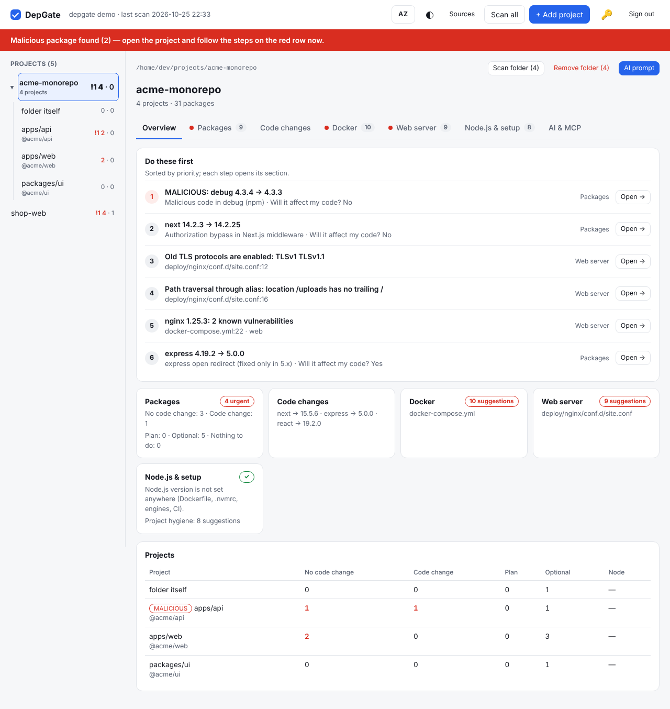
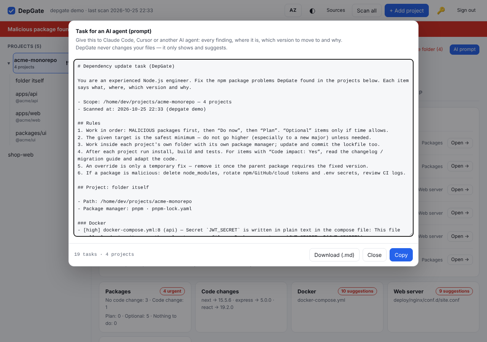
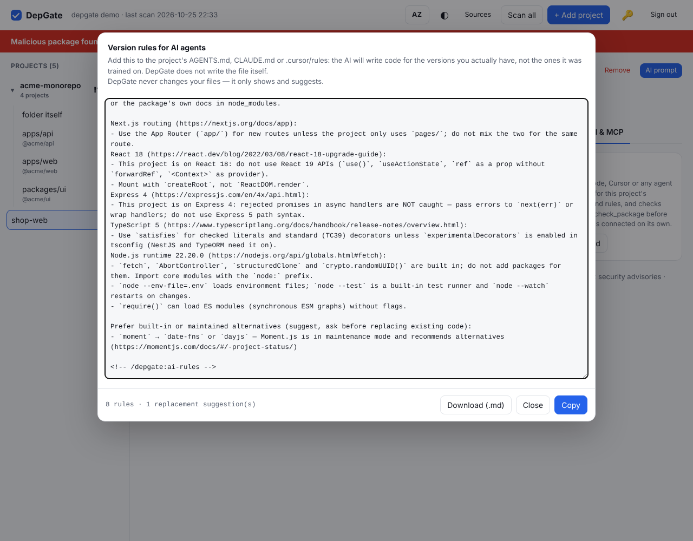
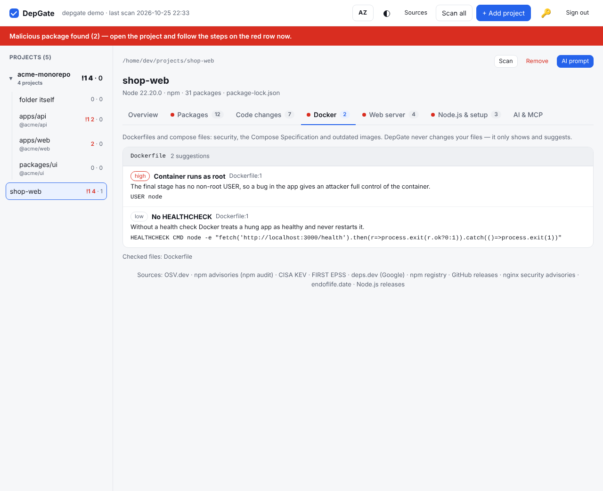
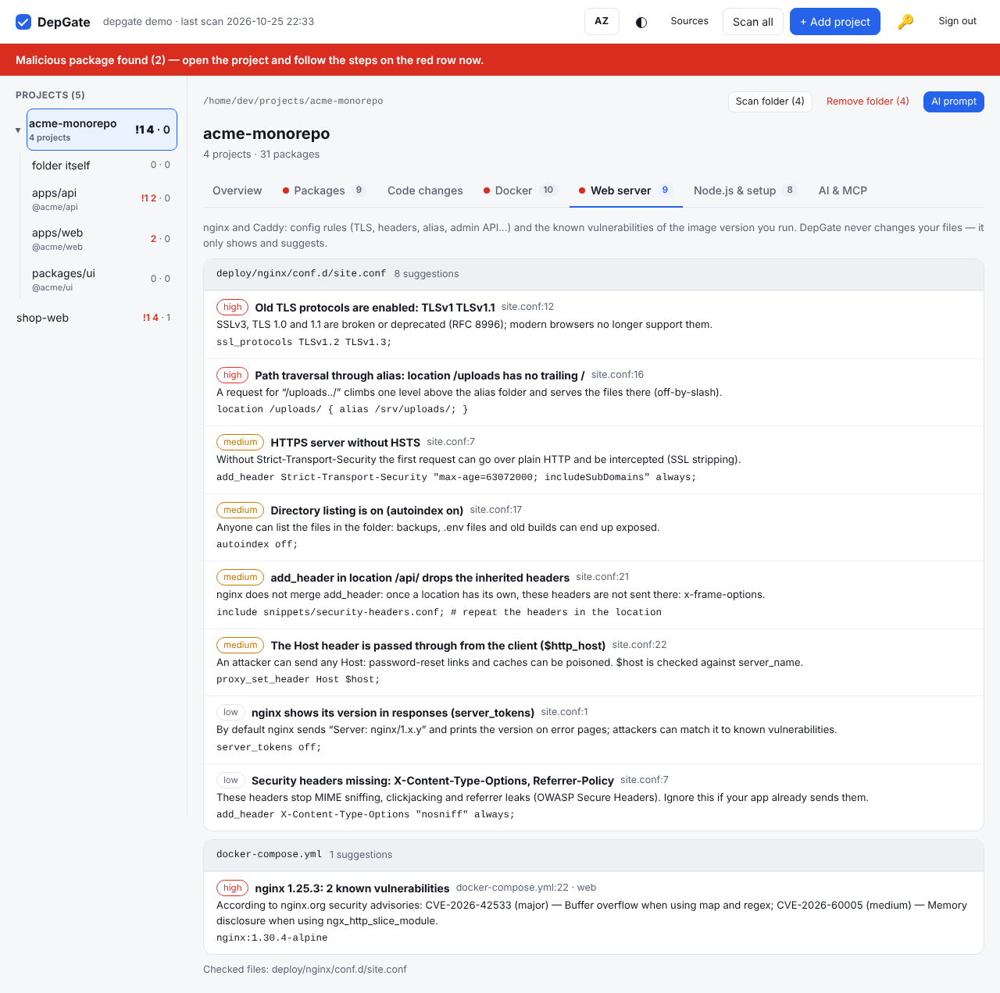
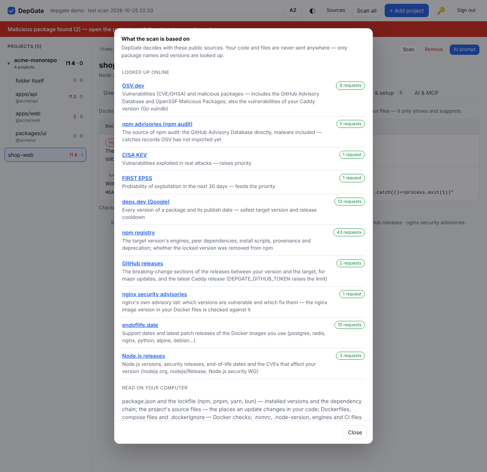

<p align="center"></p>

<h1 align="center">DepGate</h1>

<p align="center"><b>npm asılılıqların bir ekranda: nəyi indi yeniləmək lazımdır, nə gözləyə bilər, yeniləmə kodunu sındırırmı və dəqiq harada.</b><br>
Lokal veb interfeys · Docker · sıfır asılılıq · Azərbaycan və ingilis dili</p>

<p align="center"><a href="#tez-başla">Tez başla</a> · <a href="#imkanlar">İmkanlar</a> · <a href="#mcp">MCP</a> · <a href="#nə-yoxlayır">Nə yoxlayır</a> · <a href="#mənbələr">Mənbələr</a> · <a href="#docker">Docker</a> · <a href="README.md">English</a></p>

---

`npm audit` nəyinsə zəif olduğunu deyir. DepGate isə **nə etməli olduğunu** deyir:

| Hər paket üçün | DepGate-in cavabı |
|---|---|
| ① **Yeniləmək lazımdır?** | Zərərli paket və critical/high CVE üçün **DƏRHAL** (CISA KEV + EPSS ilə çəkilir) · növbəti baxımda · planla · istəyə görə · lazım deyil |
| ② **Koda təsir edir?** | **Xeyr** — patch/minor, bir əmr · **Ola bilər** — peer/engines münaqişəsi · **Bəli** — breaking reliz |
| 📍 **Kodumda harada?** | Dəyişməli olan hər yer — `fayl:sətir`, səbəb, əvəzinə nə yazmaq lazımdır — və rəsmi codemod |
| 🎯 **Hansı versiya?** | «Ən təhlükəsiz minimum»: cari major-da zəifliyi olmayan ən kiçik versiya, səni sındıra biləcək «latest» yox |
| 🔗 **Dolayı paketdirsə?** | Valideynin aralığı icazə verirsə lockfile yeniləməsi, yoxsa birbaşa valideynin yenilənməsi, o da olmasa hazır `overrides` bloku |
| 🧩 **Tək yenilənir?** | `react` + `react-dom`, `next` + `eslint-config-next`, `@nestjs/*`, `@angular/*`… bir qrup və bir əmr kimi göstərilir |
| 🕵️ **Yeni versiyanın özü təhlükəsizdirmi?** | 3 gündən yeni versiyaları keçir; yeni install skriptini, itən npm provenance-ı, dəyişən dərc edəni və ya repo-nu işarələyir |
| 🤖 **AI agentim edə bilər?** | Bütün dəyişikliklərlə hazır bir prompt, agentin *sənin* versiyalarına görə kod yazması üçün `AGENTS.md` bloku. Agent DepGate-dən **MCP** ilə özü də soruşa bilər: hər layihəyə ayrıca qoşulur və hər paketi quraşdırmazdan əvvəl yoxlayır |

Node.js runtime-ı, Dockerfile və compose faylları da yoxlanır. Hər şey sənin kompüterində işləyir və DepGate **heç bir faylı dəyişmir** — yalnız göstərir və təklif edir.

Hər layihə (və hər qovluq) **Ümumi** bölməsində açılır: əvvəlcə nə etmək lazım olduğu prioritetə görə sıralanır, hər bölmə üçün bir kart var. Qalanı bölmələrə ayrılıb, ona görə hər dəfə bir şey görürsən: **Paketlər** (hər paket bir kompakt sətir, tam cavab üçün sətirə klikləyirsən), **Kod dəyişiklikləri**, **Docker**, **Node.js və mühit**, **AI və MCP**.


## Niyə indi

2026-cı il npm təchizat zənciri üçün ən ağır il oldu:

- **Mart** — həftədə 100 milyondan çox yüklənən [Axios paketi](https://unit42.paloaltonetworks.com/axios-supply-chain-attack/) Şimali Koreya ilə əlaqəli qrup tərəfindən ələ keçirildi və arxa qapı ilə yayıldı.
- **May** — [Mini Shai-Hulud qurdu](https://braindetox.kr/en/posts/npm_supply_chain_attack_2026.html) 22 dəqiqədə 314 paketi 637 zərərli versiya ilə əvəz etdi.
- **İyun** — `binding.gyp` vasitəsilə [57 paket](https://threatcluster.io/cluster/large-scale-supply-chain-attack-targets-npm-packages-via-bin-4588b024) ələ keçirildi; kod `npm install` zamanı işləyirdi.
- **Oktyabr** — Node.js-in özündə Brotli RCE (CVE-2026-111497) daxil olmaqla [10 zəiflik düzəldildi](https://securityonline.info/nodejs-security-release-october-2026/).

Dependabot hər paket üçün ayrıca PR açır; `npm audit fix --force` major-ları atlayıb build-i sındıra bilər. DepGate bütün layihələrinin tam mənzərəsini runtime ilə birlikdə göstərir və hər biri üçün ən kiçik təhlükəsiz addımı verir.

<a id="tez-başla"></a>
## Tez başla

```bash
go install github.com/Ali7Zeynalli/depgate@latest
depgate            # http://127.0.0.1:7777 açılır — parol təyin et, sonra «+ Layihə əlavə et»
```

və ya Docker ilə:

```bash
git clone https://github.com/Ali7Zeynalli/depgate.git && cd depgate
DEPGATE_UID=$(id -u) DEPGATE_GID=$(id -g) docker compose up -d
```

`http://127.0.0.1:7777` aç, parol seç və ev qovluğunun istənilən yerindən layihə əlavə et.

AI agentini layihəyə qoş ([MCP](#mcp)-yə bax). Ən asan yol interfeysin **AI və MCP** bölməsindəki **Qoşulma əmri** düyməsidir, orada əmr layihə yolu və token ilə hazır olur. Əl ilə belədir:

```bash
cd ~/projects/shop && claude mcp add --transport http depgate -s local \
  "http://127.0.0.1:7777/mcp?project=$PWD" --header "Authorization: Bearer $(depgate --print-token)"
# Docker-də token:  docker exec depgate depgate --print-token
```

Faydalı olsa, ⭐ başqa developerlərin onu tapmasına kömək edir.

<a id="imkanlar"></a>
## İmkanlar

### 📍 Kodunda nə dəyişəcək

"Koda təsir: Bəli" yazmaq kifayət deyil, ona görə DepGate **harada** dəyişəcəyini də göstərir. Yeniləmə sənədləşdirilmiş breaking reliz-dən keçirsə, layihənin öz fayllarını oxuyur və dəyişməli olan hər yeri sıralayır. Oxuma kompüterində gedir, heç nə göndərilmir. Hər yer üçün `fayl:sətir`, sətrin özü, niyə sınacağı və əvəzinə nə yazmaq lazım olduğu göstərilir. Əl ilə yoxlanmalı olan şeylər və mövcud olanda rəsmi codemod da yazılır. Belə yerlər tapılsa, kart «İndi et — kod dəyişir» qrupuna keçir.

Dəqiq yerlərlə əhatə olunanlar: **Next.js 15 və 16, React 18 və 19, TanStack Query 5, ESLint 9, Tailwind CSS 4, Express 5, NestJS 11, Zod 4, Prisma 7, React Router 6 və 7**. Angular, Nx, Storybook və Expo üçün onların rəsmi upgrade alətləri göstərilir. Major yeniləməsi olan digər paketlər üçün sənin versiyan ilə hədəf arasındakı GitHub release-lərin *Breaking changes* bölmələri göstərilir.

Təklif olunan hədəfdən sonra daha yeni major varsa, bağlı **«Yeni major-a keçsən»** bölməsi o keçidin nələrə toxunacağını göstərir. Beləcə onu bugünkü cavabı dəyişmədən planlaya bilərsən. Axtarış mətn nümunələrinə əsaslanır: hər yeri yoxla, sonra build və testləri işlət.


### 🗂 Qovluqlar və monorepo-lar

Qovluq əlavə edəndə (monorepo və ya bir neçə layihənin olduğu qovluq) sol paneldə bir başlıq kimi görünür, layihələri isə onun altında öz yolları ilə sıralanır. Qovluğun adına klikləyəndə hamısının ümumi səhifəsi açılır: layihələr cədvəli, cəm göstəricilər, sonra bütün tapıntılar kateqoriyalar üzrə. Eyni tapıntı bir neçə layihədə varsa, bir dəfə göstərilir: altında hansı layihələrdə olduğu və hər biri üçün `cd … && …` əmri yazılır. **Qovluğu skan et** və **Qovluğu sil** hamısına birlikdə təsir edir.



### 🤖 AI prompt və AI qaydaları

- **AI üçün prompt** (qovluqda və ya layihədə) Claude Code, Cursor və ya istənilən agent üçün bir tapşırıq yazır. Orada dəyişməli olan hər paket, harada olduğu, hansı versiyaya və niyə keçməli olduğu, advisory-lər, koda təsiri, kodundakı yerlər və codemod-lar olur. Qaydalar da var: əvvəl zərərli paketlər, ən təhlükəsiz minimum versiya, hər layihədən sonra build və testlər. Sonda agentin nəyi hesabat verməli olduğu yazılır.
- **AI qaydaları** lockfile-dakı versiyalardan `AGENTS.md` / `CLAUDE.md` / `.cursor/rules` üçün blok hazırlayır. AI modelləri köhnə versiyalarla öyrədilib: Next.js 16 layihəsində `getServerSideProps`, ESLint 9-da `.eslintrc` yazırlar. Blokda bunlar olur:
  - dəqiq stack;
  - versiyaya uyğun qaydalar (Next.js, React, Tailwind, ESLint, Express, NestJS, Prisma, Zod, TanStack Query, React Router, TypeScript, Node.js), rəsmi upgrade bələdçilərinin linkləri ilə;
  - köhnəlmiş paketlərin daxili və ya dəstəklənən əvəzləri (`request`, `moment`, `node-fetch`, `dotenv`, `rimraf` və s.).

Hər ikisini kopyalaya və ya `.md` kimi yükləyə bilərsən; DepGate onları layihənə yazmır.




<a id="mcp"></a>
### 🔌 MCP ilə AI agentlər

`depgate mcp` [Model Context Protocol](https://modelcontextprotocol.io) server-idir. Claude Code, Cursor, VS Code və ya istənilən MCP klienti DepGate-dən özü soruşur, sənin promptu kopyalayıb yapışdırmağına ehtiyac qalmır. Hər layihə üçün ayrıca işləyir: alətlər agentin açıldığı layihəyə (və ya `--project` ilə verilənə) aiddir. Hər çağırışda başqa layihə də göstərmək olar: yol, paket adı və ya monorepo içində qovluq, məsələn `apps/api`.

```bash
# HTTP ilə işləyən DepGate-ə (tövsiyə: interfeyslə eyni data, Docker-də də işləyir)
cd ~/projects/shop && claude mcp add --transport http depgate -s local \
  "http://127.0.0.1:7777/mcp?project=$PWD" --header "Authorization: Bearer $(depgate --print-token)"
# Docker-də token:  docker exec depgate depgate --print-token
# və ya stdio ilə, agent DepGate-i özü işə salır
cd ~/projects/shop && claude mcp add depgate -s local -- depgate mcp --project "$PWD"
```

**Agent məlumatı haradan alır**

| Qoşulma | Data | Nə vaxt |
|---|---|---|
| **HTTP** — DepGate token-i ilə `http://127.0.0.1:7777/mcp?project=…` | işləyən DepGate server: interfeysdəki eyni layihələr və hesabatlar | həmişə tövsiyə olunur. DepGate Docker-də işləyəndə və agent başqa kompüterdə olanda da istifadə et. Başqa kompüter üçün DepGate-i `--addr 0.0.0.0 --allow-host <ad>` ilə başlat və token-i gizli saxla |
| **stdio** — `depgate mcp --project …` | lokal data qovluğu (`~/.config/depgate`), `docker exec -i depgate depgate mcp` ilə isə konteynerin datası | server işləmir; CI; offline |

stdio lokal layihə tapmasa və eyni vaxtda DepGate server işləyirsə, bunu deyir və HTTP qoşulmasını tövsiyə edir. `/mcp` yalnız `Authorization: Bearer` token-i qəbul edir (brauzer sessiyası işləmir). Yad `Origin` başlığını rədd edir və yalnız DepGate-in icazə verilən qovluqlarını oxuyur.

Hər layihə və qovluğun **AI və MCP** bölməsindəki **Qoşulma əmri** düyməsi bu əmrləri yolu doldurulmuş halda göstərir. Cursor və digər kliyentlər üçün JSON da orada var.

| Alət | Agent nə alır |
|---|---|
| `project_status` | skan vaxtı, Node.js, saylar, indi ediləcəklər, birlikdə yenilənən qruplar, Docker problemləri |
| `get_findings` | tapıntılar: hədəf versiya, səbəb, koda təsir və dəqiq əmr |
| `get_fix_plan` | bütöv, ardıcıl tapşırıq (monorepo-nun bütün layihələri üçün də) |
| `get_code_changes` | bir paket üçün: dəyişəcək `fayl:sətir` yerləri, codemod, əl ilə yoxlamalar, release notes |
| `get_ai_rules` | kod yazmaq üçün dəqiq stack və versiya qaydaları |
| `check_package` | **hər quraşdırmadan əvvəl**: `ad@versiya` təhlükəsizdirmi — zəifliklər, zərərli paket, silinmiş və ya təzə çıxmış versiya, install skriptləri, provenance, Node və peer uyğunluğu — və əvəzinə hansı versiya |
| `get_docker_issues` | Dockerfile, compose və image tapıntıları: fayl, sətir, səbəb və əvəzinə yazılacaq sətir |
| `scan_project` | dəyişiklikdən sonra yenidən skan edib təsdiqləmək |
| `list_projects` | DepGate-in bildiyi bütün layihələr |

Server DepGate-in data qovluğunu istifadə edir, yəni interfeysdəki layihələr və hesabatlar burada da görünür. Hesabatı olmayan layihəni lazım olanda skan edir. Heç vaxt layihə əlavə etmir və fayl dəyişmir. Advisory və release notes mətnləri məlumat kimi sitat gətirilir ki, AI onları əmr kimi qəbul etməsin.


### 🧩 Birlikdə yenilə

Bəzi paketlər həmişə birlikdə buraxılır: `react` + `react-dom` (+ uyğun `@types/react`), `next` + `eslint-config-next`, əsas `@nestjs/*` paketləri, `@angular/*`, Vue, Storybook, Nx, Prisma, typescript-eslint, Tiptap. Onlardan biri yeni versiyaya keçməlidirsə və ya versiyaları bir-birindən ayrılıbsa, DepGate bir kart göstərir: hər paket, onun hədəf versiyası və hamısı üçün bir əmr. Öz versiya xətti olan paketlər (məsələn `@nestjs/config`) qrupa salınmır.

### 🐳 Docker: təhlükəsizlik, Compose standartı, image-lər

Layihədəki və repo kökündəki Dockerfile və compose faylları üç cür yoxlanır. Hər tapıntıda fayl, sətir, servis və əvəzinə yazılacaq sətir göstərilir; sirlərin dəyəri heç vaxt göstərilmir.

- **Təhlükəsizlik** (25 qayda): konteynerin root ilə işləməsi, `latest` teqləri, `ENV`/`ARG`/`environment` içində sirlər, `npm ci` əvəzinə `npm install`, `curl | sh`, `.dockerignore`-un olmaması (bu halda `.env` image-ə düşə bilər), `privileged`, Docker socket-in konteynerə bağlanması, bütün interfeyslərə açılmış verilənlər bazası, host şəbəkəsi və ya PID, söndürülmüş seccomp/AppArmor və s.
- **Compose Specification:** bilinməyən və ya səhv yazılmış açarlar (`enviroment` → `environment`), istifadə olunan, amma elan olunmamış volume və şəbəkələr, mövcud olmayan servisə `depends_on`, healthcheck-i olmayan servisə `condition: service_healthy`, olmayan `env_file` və build qovluqları, köhnəlmiş `version:` açarı, köhnə `links`. Bundan əlavə production üçün çatışmayan əsaslar da göstərilir: healthcheck, restart siyasəti, yaddaş limiti.
- **Image-lər** ([endoflife.date](https://endoflife.date) əsasında): dəstəyi bitmiş xətlər (`redis:6.2`, `postgres:12`, `python:3.8`), dörd ay içində bitəcək xətlər, ən son patch-dən geri qalan sabit versiyalar (`postgres:15.2` → `15.14`) və dəstəyi bitmiş OS variantları (`node:18-buster`, `…-alpine3.16`). Bu yoxlama postgres, redis, nginx, python, mysql, mariadb, mongo, php, golang, ruby, rabbitmq, elasticsearch, alpine, debian, ubuntu və başqaları üçün işləyir. Node.js image-ləri Node.js kartında yoxlanır.

DepGate image-ləri yükləmir. Ona görə image-in *içindəki* sistem paketlərinin CVE-lərini sıralaya bilmir; bunun üçün Trivy kimi image skaneri lazımdır. Dəstəyi bitmiş base image və ya OS isə o CVE-lərin heç vaxt düzəlməyəcəyinin ən güclü əlamətidir.



### 🌐 Veb server: nginx və Caddy

Layihədə nginx konfiqurasiyası (`nginx.conf`, `nginx/`, `conf.d/`, `sites-*/` qovluqlarındakı fayllar, `*.conf.template`) və ya `Caddyfile` varsa, **Veb server** bölməsi görünür. DepGate konfiqurasiyaları bir neçə qovluq dərinliyə qədər oxuyur (`node_modules`, build qovluqları və başqa workspace-lər keçilir). Dockerfile və compose fayllarındakı nginx / Caddy image-lərinə də baxır:

- **Versiyanın məlum zəiflikləri.** nginx: image teqi (`nginx:1.25.3-alpine`, `nginx:1.27`, `nginxinc/nginx-unprivileged`) [nginx-in öz təhlükəsizlik siyahısı](https://nginx.org/en/security_advisories.html) ilə yoxlanır, «Not vulnerable» sətirləri də nəzərə alınır. DepGate hamısını düzəldən ən kiçik versiyanı təklif edir. Caddy: versiya OSV.dev-də (Go vulndb, `github.com/caddyserver/caddy/v2`) yoxlanır, son buraxılışdan geri qalan Caddy xətti də göstərilir. Üzən teqlər (`stable`, `latest`, `2`) yoxlanmır.
- **nginx konfiqurasiyası:** SSLv3 / TLS 1.0 / 1.1, zəif şifrlər (RC4, 3DES, MD5, NULL, EXPORT), `autoindex on`, `alias` ilə yol keçidi (off-by-slash), location-dakı `add_header`-ın server başlıqlarını səssizcə silməsi, başlıqlarda və yönləndirmələrdə `$uri` (CRLF injection), `proxy_set_header Host $http_host`, istifadəçinin idarə etdiyi `proxy_pass` hədəfi (SSRF), HSTS-siz HTTPS, `X-Content-Type-Options` / frame qorunması / `Referrer-Policy` olmaması, söndürülməmiş `server_tokens`. Snippet fayllarının `include`-u izlənir, ona görə snippet-də saxlanan başlıqlar da sayılır.
- **Caddyfile:** localhost-dan kənara açıq admin API, `file_server browse`, `protocols tls1.0/1.1`, upstream-ə `tls_insecure_skip_verify`, ictimai domendə `tls internal`, `debug`, HSTS, `nosniff`, `Referrer-Policy` və ya `-Server` olmayan ictimai saytlar. Snippet-lər (`import`) açılır; DepGate-in görə bilmədiyi import olanda başlıq yoxlamaları təxmin etmək əvəzinə susur.

Qaydalar [gixy](https://github.com/yandex/gixy) (nginx konfiqurasiya xətaları), [Mozilla SSL Configuration](https://ssl-config.mozilla.org/), [OWASP Secure Headers](https://owasp.org/www-project-secure-headers/), nginx və Caddy sənədlərinə əsaslanır. Bunlar fayllar üzərində mətn yoxlamalarıdır: tətbiqin özünün göndərdiyi başlığı görmürlər.



<a id="nə-yoxlayır"></a>
## Nə yoxlayır

- **Lockfile-lar:** `package-lock.json` (v1–v3), `pnpm-lock.yaml` (v5–v9), `yarn.lock` (v1 və Berry), `bun.lock`, workspace-lər daxil. Dolayı paketlər də yoxlanır. Lockfile yoxdursa `node_modules`-dan oxuyur, o da yoxdursa açıq işarələnmiş «təxmini» rejimə keçir.
- **Zəifliklər və zərərli paketlər:** OSV.dev və npm advisory endpoint-i (`npm audit`-in məlumatı) təkrarsız birləşdirilir. `npm audit`-in buraxdığı prerelease versiyalar da yoxlanır.
- **Silinmiş versiyalar:** npm-in artıq vermədiyi versiya. Bu halda təmiz quraşdırma alınmayacaq; npm zərərli versiyaları silir. `0.0.1-security` ilə əvəzlənmiş paket zərərli kimi göstərilir.
- **Prioritet (0–100):** severity + [CISA KEV](https://www.cisa.gov/known-exploited-vulnerabilities-catalog) + [EPSS](https://www.first.org/epss/).
- **Ən təhlükəsiz minimum hədəf:** eyni major xəttində zəifliyi olmayan ən kiçik versiya; gözləmə müddətindən yeni versiyalar keçilir.
- **Dolayı paket düzəlişi:** relock → birbaşa valideynin yenilənməsi → `overrides` / `resolutions` bloku.
- **Koda təsir:** semver fərqi, hədəf versiyanın `engines.node` və `peerDependencies` tələbləri və breaking relizin kodunda toxunduğu yerlər.
- **Hədəf versiyada təchizat zənciri siqnalları:** yeni install skripti, itən npm provenance, fərqli dərc edən, dəyişən repo linki.
- **Node.js runtime:** Dockerfile, `.nvmrc`, `.node-version`, `.tool-versions`, `engines`, GitHub Actions; təhlükəsizlik relizləri, EOL tarixləri və dəqiq versiyana aid CVE-lər.
- **Docker:** Dockerfile və compose təhlükəsizliyi (yuxarıya bax).
- **Veb server:** nginx və Caddy konfiqurasiyaları və istifadə etdiyin nginx / Caddy versiyasının məlum zəiflikləri (yuxarıya bax).
- **Layihə gigiyenası:** lockfile commit olunub, install skriptləri söndürülüb, gözləmə müddəti ayarlanıb, Node versiyası hər yerdə eynidir.

<a id="mənbələr"></a>
## Mənbələr

Hər qərar açıq və pulsuz mənbələrə əsaslanır. **Mənbələr** düyməsi onları göstərir: hər mənbə nə üçün istifadə olunur və son skanda neçə sorğuya cavab verib (və ya alınmayıb). Eyni siyahının linki hər layihənin altında da var.

| Mənbə | Nə üçün |
|---|---|
| [OSV.dev](https://osv.dev) | zəifliklər (CVE/GHSA) və zərərli paketlər — GitHub Advisory Database və OpenSSF Malicious Packages daxil; Caddy versiyasının zəiflikləri də (Go vulndb) |
| [npm advisories](https://docs.npmjs.com/cli/commands/npm-audit) | `npm audit`-in mənbəyi: GitHub Advisory Database birbaşa, zərərli paketlər daxil — OSV-nin hələ almadığı qeydləri tutur |
| [CISA KEV](https://www.cisa.gov/known-exploited-vulnerabilities-catalog) | real hücumlarda istifadə olunan zəifliklər (prioriteti qaldırır) |
| [FIRST EPSS](https://www.first.org/epss/) | yaxın 30 gündə istismar ehtimalı (prioritetə təsir edir) |
| [deps.dev](https://deps.dev) | paketin bütün versiyaları və buraxılış tarixləri (hədəf versiya, gözləmə müddəti) |
| [npm registry](https://www.npmjs.com) | hədəf versiyanın `engines`, peer asılılıqları, install skriptləri, provenance, deprecated qeydi; lockfile-dakı versiyanın hələ mövcud olub-olmadığı |
| [GitHub releases](https://docs.github.com/en/rest/releases/releases) | major yeniləmələrdə versiyan ilə hədəf arasındakı release-lərin breaking changes bölmələri; Caddy-nin son versiyası |
| [nginx security advisories](https://nginx.org/en/security_advisories.html) | hansı nginx versiyalarının zəif olduğu və hansında düzəldiyi |
| [endoflife.date](https://endoflife.date) | istifadə etdiyin Docker image-lərinin dəstək müddəti və son patch versiyaları |
| [Node.js releases](https://nodejs.org/en/about/previous-releases) + [Node.js Security WG](https://github.com/nodejs/security-wg) | Node.js versiyaları, təhlükəsizlik relizləri, EOL tarixləri və dəqiq versiyana aid CVE-lər |

Kompüterində oxunanlar heç yerə göndərilmir: `package.json`, lockfile, mənbə faylların («Kodunda nə dəyişəcək» üçün), Dockerfile və compose faylları, nginx konfiqurasiyaları və Caddyfile-lar, `.nvmrc` / `.node-version` / `engines` / CI faylları, `.npmrc`, `.dockerignore`.

**Dəqiqlik.** `TestCompareNpmAudit` testi məlum zəif asılılıqları olan bir layihəni skan edir. Sonra `npm audit`-in tapdığı hər advisory-nin DepGate hesabatında da olduğunu yoxlayır (yazılan vaxt 71/71). Test GitHub Actions-da hər həftə işləyir (`accuracy` workflow). Lokal işlətmək üçün: `DEPGATE_LIVE=1 go test -run TestCompareNpmAudit -v ./internal/scan`.



## İstifadə

### Veb interfeys (əsas rejim)

```bash
depgate
```

`http://127.0.0.1:7777` açılır. İnterfeys iki dillidir (Azərbaycan / ingilis): brauzerin dilinə uyğun açılır, **AZ / EN** düyməsi isə yenidən skan etmədən dərhal dəyişir. **+ Layihə əlavə et** düyməsini bas, qovluqları gəz (`package.json` olanlar «layihə» kimi işarələnib) və layihəni seç. Bütöv qovluq da seçmək olar: altındakı bütün layihələr, monorepo üzvləri daxil, əlavə olunur və arxa planda skan edilir.

Layihə siyahısı və son hesabatlar yadda qalır (`~/.config/depgate`), növbəti dəfə hamısı yerindədir. Hər layihə üçün **Skan et**, **Siyahıdan sil**, **AI üçün prompt** düymələri və bölmələr var: Ümumi · Paketlər · Kod dəyişiklikləri · Docker · Node.js və mühit · AI və MCP. Açıq bölmə ünvanda saxlanır, ona görə səhifəni yeniləyəndə və ya linki paylaşanda eyni bölmə açılır. Qovluqda eyniləri bütün layihələrinə təsir edir. Yuxarıda **Hamısını skan et** var. Layihə qovluğunda `depgate` (və ya `depgate ~/projects`) yazsan, dərhal əlavə olunur.

Qovluq seçici yalnız icazə verilən kökləri göstərir (standart: ev qovluğu; `--root` ilə dəyişir).


<a id="docker"></a>
### Docker

```bash
DEPGATE_UID=$(id -u) DEPGATE_GID=$(id -g) docker compose up -d
```

və ya compose-suz:

```bash
docker run -d --name depgate -p 127.0.0.1:7777:7777 --user "$(id -u):$(id -g)" \
  -e HOME=$HOME -e DEPGATE_ROOTS=$HOME \
  -v $HOME:$HOME:ro -v depgate-data:/data \
  --read-only --tmpfs /tmp --cap-drop ALL ghcr.io/ali7zeynalli/depgate:latest
```

- **Ev qovluğun eyni yolla, yalnız oxuma rejimində bağlanır.** Ona görə interfeysdə real yollar görünür və heç nəyi köçürmək lazım deyil. DepGate ora heç nə yazmır.
- Konteyner **sənin istifadəçinlə** işləyir (`DEPGATE_UID`/`DEPGATE_GID`, standart 1000) ki, fayllarını oxuya bilsin. Əvvəlcə qısa `depgate-init` addımı data volume-unu həmin istifadəçiyə verir; köhnə versiyaların yaratdığı volume-ları da düzəldir.
- Siyahı, hesabatlar və parol hash-ı **`depgate-data` Docker volume-unda** saxlanır və yenidən başlatmada və yeniləmədə itmir. Docker-siz `depgate` ilə ortaq istifadə etmək istəsən, volume-u `${HOME}/.config/depgate:/data` ilə əvəz et (`docker-compose.yml`-dəki şərhə bax).
- Port yalnız `127.0.0.1`-də açılır. `DEPGATE_PASSWORD=…` parolu əvvəlcədən təyin edir; `DEPGATE_GITHUB_TOKEN=…` release notes üçün GitHub limitini artırır.

### Bir dəfəlik rejimlər

```bash
depgate --json > report.json # skan et, JSON yaz (schema depgate/report@1)
depgate --view report.json   # saxlanmış hesabatı interfeysdə aç
depgate --ci --fail-on high  # CI: high/critical və ya zərərli paket varsa çıxış kodu 1
depgate --push URL --token T # skan et və hesabatı göndər
depgate --offline            # şəbəkəsiz, yalnız keşdən
depgate mcp --project DIR    # AI agentlər üçün MCP server (stdio)
```

| Bayraq | Nə edir | Standart |
|---|---|---|
| `--port` | Veb interfeysin portu (məşğuldursa növbəti) | 7777 |
| `--addr` | Dinlənilən ünvan | 127.0.0.1 (Docker-də 0.0.0.0) |
| `--root` | Gəzilə bilən qovluq (təkrarlana bilər; `DEPGATE_ROOTS`) | ev qovluğu |
| `--data` | Siyahı, hesabatlar, parol hash-ı (`DEPGATE_DATA`) | `~/.config/depgate` |
| `--allow-host` | Əlavə icazəli `Host` adı, məsələn lokal şəbəkə adı (təkrarlana bilər) | — |
| `--print-token` | API/MCP token-ini çap et (Docker: `docker exec depgate depgate --print-token`) | — |
| `--reset-password` | Parolu unut; növbəti açılışda yenisi istənir | — |
| `--no-auth` | Parolu söndür (yalnız 127.0.0.1; tövsiyə olunmur) | söndürülüb |
| `--no-open` | Brauzeri avtomatik açmır | açır |
| `--offline` | Şəbəkəyə heç vaxt çıxmır | söndürülüb |
| `--depth` | Layihə axtarışının dərinliyi | 3 |
| `--cooldown` | Bundan yeni versiyaları (gün) hədəf seçmir | 3 |
| `--json`, `--view`, `--ci`, `--fail-on`, `--push`, `--token` | Yuxarıdakı bir dəfəlik rejimlər | — |

| Mühit dəyişəni | Nə edir |
|---|---|
| `DEPGATE_PASSWORD` | Parolu əvvəlcədən təyin edir (ən azı 8 simvol) |
| `DEPGATE_GITHUB_TOKEN` | Release notes üçün GitHub token-i (heç bir icazə lazım deyil), saatda 60 sorğu limitini artırır; `GITHUB_TOKEN` də işləyir |
| `DEPGATE_TOKEN` | Skriptlər üçün API token-i (`Authorization: Bearer …`) |
| `DEPGATE_ROOTS`, `DEPGATE_DATA` | `--root` və `--data` ilə eynidir |
| `DEPGATE_PUSH_TOKEN` | `--push` üçün token |
| `DEPGATE_PROJECT` | `depgate mcp` üçün standart layihə (`--project` ilə eyni) |
| `DEPGATE_LANG=az` | Terminal mesajları Azərbaycan dilində |

## Kənara nə gedir

Kompüterindən yalnız açıq paket məlumatı çıxır: paket adları və versiyalar (OSV, npm, deps.dev), CVE nömrələri (EPSS), major yeniləməsi olan paketlərin GitHub repo adları (release notes üçün) və Docker image-lərinin məhsul adları (endoflife.date). Kod, fayl yolları, layihə adları və `.env` faylları heç vaxt getmir. Cavablar `~/.cache/depgate/` qovluğunda keşlənir.

Veb interfeys `127.0.0.1`-də işləyir (Docker-də host-un `127.0.0.1`-inə açılır) və parolla qorunur. Həmçinin `Host` başlığını yoxlayır və sərt Content Security Policy göndərir. Qovluq gəzmə icazəli köklərlə məhdudlaşır və DepGate layihələri yalnız oxuyur.

## Parol niyə lazımdır?

DepGate kompüterində `127.0.0.1:7777` ünvanında kiçik veb server işlədir. Qorunmasa, o ünvana çata bilən hər şey ondan istifadə edə bilər:

- **açdığın başqa saytlar** — zərərli səhifə və ya reklam brauzerin üzərindən `127.0.0.1`-ə sorğu göndərib (CSRF, DNS rebinding) qovluqlarını, layihə adlarını və hesabatları oxumağa cəhd edə bilər;
- **eyni kompüterdəki başqa proqramlar və istifadəçilər** — localhost portu hamısına açıqdır;
- **şəbəkə** — Docker portu səhvən `0.0.0.0`-a açılsa, eyni Wi-Fi-dakı hər kəs interfeysi görə bilər.

DepGate qovluqlarını gəzə bilir və layihələrinin zəif yerlərini göstərir — hücumçunun axtardığı məhz budur. Ona görə interfeys parolla qorunur:

- **ilk açılış:** parolu özün seçirsən (ən azı 8 simvol) — heç bir token, kopyalanacaq link yoxdur;
- **sonra:** adi giriş səhifəsi, «məni yadda saxla» (30 gün); yuxarıda **Çıxış** və **Parolu dəyiş** düymələri var (parol dəyişəndə digər brauzerlərdəki sessiyalar bağlanır);
- **unutmusan?** `depgate --reset-password` (Docker-də: `docker exec depgate depgate --reset-password`), sonra yenisini təyin et;
- **Docker / avtomatlaşdırma:** `DEPGATE_PASSWORD=…` parolu əvvəlcədən təyin edir; skriptlər API-ni `Authorization: Bearer <token>` ilə çağırır (token `~/.config/depgate/token` faylındadır; Docker-də onu `DEPGATE_TOKEN` ilə özün təyin et).

Parol yalnız PBKDF2-SHA256 hash kimi saxlanır (600 000 iterasiya, təsadüfi salt); ardıcıl yanlış cəhdlər yavaşladılır. Bundan əlavə DepGate `Host` başlığını yoxlayır, hər API sorğusunda xüsusi başlıq tələb edir və sərt Content Security Policy göndərir.

## İnkişaf

```bash
go test ./...
go vet ./...
go run . ./testdata/lockfiles/npm-v3
```

Yalnız standart kitabxana, üçüncü tərəf Go modulu yoxdur. [CONTRIBUTING.md](CONTRIBUTING.md)-yə bax. Təhlükəsizlik bildirişləri: [SECURITY.md](SECURITY.md).

## Lisenziya

[MIT](LICENSE)
