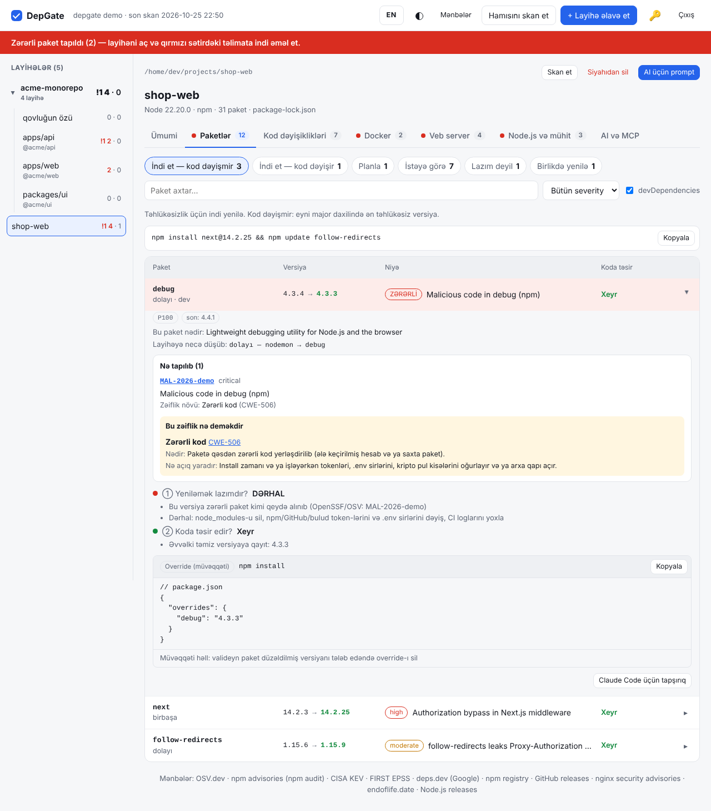

<p align="center"></p>

<h1 align="center">DepGate</h1>

<p align="center"><b>npm asılılıqların bir ekranda: nəyi indi yeniləmək lazımdır, nə gözləyə bilər və yeniləmə kodunu sındırırmı.</b><br>
Lokal veb interfeys · Docker · sıfır asılılıq · Azərbaycan və ingilis dili</p>

<p align="center"><a href="README.md">English</a></p>

---

`npm audit` nəyinsə boşluqlu olduğunu deyir. DepGate isə **nə etməli olduğunu** deyir:

| Hər paket üçün | DepGate-in cavabı |
|---|---|
| ① **Yeniləmək lazımdır?** | Zərərli paket və critical/high CVE üçün **DƏRHAL** (CISA KEV + EPSS ilə çəkilir) · növbəti baxımda · planla · istəyə görə · lazım deyil |
| ② **Koda təsir edir?** | **Xeyr** — patch/minor, bir əmr · **Ola bilər** — peer/engines münaqişəsi · **Bəli** — major, miqrasiya bələdçisi ilə |
| 🎯 **Hansı versiya?** | «Ən təhlükəsiz minimum»: cari major-da boşluğu düzəldən ən kiçik versiya, «latest» yox |
| 🔗 **Dolayı paketdirsə?** | Lockfile yeniləməsi → birbaşa valideynin yenilənməsi → hazır `overrides` bloku |
| 🕵️ **Yeni versiyanın özü təhlükəsizdirmi?** | 3 gündən cavan versiyaları keçir; yeni install skriptini, itən provenance-ı, dəyişən dərc edəni və ya repo-nu işarələyir |

Hər şey sənin kompüterində işləyir. Kənara yalnız paket adları, versiyalar və CVE nömrələri gedir, kod heç vaxt getmir.



## Niyə indi

2026-cı il npm təchizat zənciri üçün ən ağır il oldu: martda 100 milyondan çox həftəlik yüklənməsi olan [Axios ələ keçirildi](https://unit42.paloaltonetworks.com/axios-supply-chain-attack/), mayda [Mini Shai-Hulud](https://braindetox.kr/en/posts/npm_supply_chain_attack_2026.html) 22 dəqiqədə 314 paketi zərərli versiyalarla əvəz etdi, iyunda `binding.gyp` vasitəsilə [57 paket](https://threatcluster.io/cluster/large-scale-supply-chain-attack-targets-npm-packages-via-bin-4588b024) götürüldü, oktyabrda isə Node.js-in özündə Brotli RCE (CVE-2026-111497) daxil olmaqla [10 boşluq düzəldildi](https://securityonline.info/nodejs-security-release-october-2026/).

Faydalı olsa, ⭐ başqa developerlərin onu tapmasına kömək edir.

## Quraşdırma

```bash
go install github.com/Ali7Zeynalli/depgate@latest
# və ya Releases-dən hazır binary (linux, macOS, Windows; amd64, arm64)
```

## İstifadə

### Veb interfeys (əsas rejim)

```bash
depgate
```

`http://127.0.0.1:7777` açılır; ilk dəfə parol təyin edirsən. Interfeys iki dillidir: brauzerin dili Azərbaycan dilidirsə, özü AZ açılır; yuxarıdakı **AZ / EN** düyməsi ilə yenidən skan etmədən dəyişir. **+ Layihə əlavə et** düyməsini bas, qovluqları gəz (`package.json` olanlar «layihə» kimi işarələnib) və layihəni seç. Bütöv qovluq da seçmək olar: altındakı bütün layihələr, monorepo üzvləri daxil, əlavə olunur və arxa planda skan edilir.

Layihə siyahısı və son hesabatlar yadda qalır (`~/.config/depgate`), növbəti dəfə hamısı yerindədir. Hər layihə üçün **Skan et** və **Siyahıdan sil**, hamısı üçün **Hamısını skan et**. Layihə qovluğunda `depgate` (və ya `depgate ~/projects`) yazsan, dərhal əlavə olunur.

Qovluq seçici yalnız icazə verilən kökləri göstərir (standart: ev qovluğu; `--root` ilə dəyişir).


### Docker

```bash
git clone https://github.com/Ali7Zeynalli/depgate.git && cd depgate
DEPGATE_UID=$(id -u) DEPGATE_GID=$(id -g) docker compose up -d
```

`http://127.0.0.1:7777` aç, parol təyin et və ev qovluğunun istənilən yerindən layihə əlavə et.

- **Ev qovluğun eyni yolla, yalnız oxuma rejimində bağlanır** — interfeysdə real yollar (`/home/sən/...`) görünür, heç nəyi köçürmək lazım deyil. DepGate ora heç nə yazmır.
- Konteyner **sənin istifadəçinlə** işləyir (`DEPGATE_UID`/`DEPGATE_GID`, standart 1000) ki, fayllarını oxuya bilsin.
- Siyahı, hesabatlar və parol hash-ı **`depgate-data` Docker volume-unda** saxlanır (yenidən başlatma və yeniləmədə itmir). Docker-siz `depgate` ilə ortaq istifadə etmək istəsən, volume-u `${HOME}/.config/depgate:/data` ilə əvəz et (`docker-compose.yml`-dəki şərhə bax).
- Port yalnız `127.0.0.1`-də açılır. `DEPGATE_PASSWORD=…` parolu brauzer əvəzinə əvvəlcədən təyin edir.

### Bir dəfəlik rejimlər

```bash
depgate --json > report.json # skan et, JSON yaz (schema depgate/report@1)
depgate --view report.json   # saxlanmış hesabatı interfeysdə aç
depgate --ci --fail-on high  # CI: high/critical və ya zərərli paket varsa çıxış kodu 1
depgate --push URL --token T # skan et və hesabatı göndər
depgate --offline            # şəbəkəsiz, yalnız keşdən
```

| Bayraq | Nə edir | Standart |
|---|---|---|
| `--port` | Veb interfeysin portu (məşğuldursa növbəti) | 7777 |
| `--addr` | Dinlənilən ünvan | 127.0.0.1 (Docker-də 0.0.0.0) |
| `--root` | Gəzilə bilən qovluq (təkrarlana bilər; `DEPGATE_ROOTS`) | ev qovluğu |
| `--data` | Siyahı, hesabatlar, token (`DEPGATE_DATA`) | `~/.config/depgate` |
| `--allow-host` | Əlavə icazəli `Host` adı (təkrarlana bilər) | — |
| `--reset-password` | Parolu unut; növbəti açılışda yenisi istənir | — |
| `--no-auth` | Parolu söndür (yalnız 127.0.0.1; tövsiyə olunmur) | söndürülüb |
| `--no-open` | Brauzeri avtomatik açmır | açır |
| `--depth` | Layihə axtarışının dərinliyi | 3 |

Terminal mesajları standart olaraq ingiliscədir; `DEPGATE_LANG=az` ilə Azərbaycan dilinə keçir.
| `--cooldown` | Bundan cavan versiyaları (gün) hədəf seçmir | 3 |

## Nə yoxlayır

- **Paketlər:** `package-lock.json` (v1–v3), `pnpm-lock.yaml` (v5–v9), `yarn.lock` (v1 və berry), `bun.lock`. Dolayı paketlər daxil. Lockfile yoxdursa `node_modules`-dan oxuyur, o da yoxdursa «təxmini» rejimə keçir.
- **Boşluqlar və zərərli paketlər:** [OSV.dev](https://osv.dev) (GitHub Advisory və OpenSSF Malicious Packages daxil).
- **Prioritet:** severity + [CISA KEV](https://www.cisa.gov/known-exploited-vulnerabilities-catalog) + [EPSS](https://www.first.org/epss/).
- **Hədəf versiya — «ən təhlükəsiz minimum»:** eyni major xəttində boşluğu düzəldən ən kiçik versiya; 3 gündən cavan versiyalar keçilir.
- **Dolayı paket:** relock → birbaşa valideynin yenilənməsi → override bloku.
- **Koda təsir:** semver fərqi, hədəf versiyanın `engines.node` və `peerDependencies` tələbləri.
- **Təchizat zənciri siqnalları:** yeni install skripti, itən provenance, dərc edən hesabın dəyişməsi, repo linkinin dəyişməsi.
- **Node.js runtime:** Dockerfile, `.nvmrc`, `.node-version`, `.tool-versions`, `engines`, GitHub Actions; təhlükəsizlik relizləri və EOL tarixləri.
- **Layihə gigiyenası:** lockfile, install skriptləri, cooldown ayarı, Node versiyasının uyğunluğu.

## Kənara nə gedir

Yalnız paket adları və versiyalar (OSV, deps.dev, npm registry), CVE nömrələri (EPSS). Kod, fayl yolları, layihə adları, `.env` heç vaxt getmir. Cavablar `~/.cache/depgate/` qovluğunda keşlənir.

Veb interfeys `127.0.0.1`-də işləyir (Docker-də host-un `127.0.0.1`-inə açılır), parolla qorunur, `Host` başlığını yoxlayır, CSP aktivdir. Qovluq gəzmə icazəli köklərlə məhdudlaşır və DepGate layihələri yalnız oxuyur.

## Parol niyə lazımdır?

DepGate kompüterində `127.0.0.1:7777` ünvanında kiçik veb server işlədir. Qorunmasa, o ünvana çata bilən hər şey ondan istifadə edə bilər:

- **açdığın başqa saytlar** — zərərli səhifə və ya reklam brauzerin üzərindən `127.0.0.1`-ə sorğu göndərib (CSRF, DNS rebinding) qovluqlarını, layihə adlarını və hesabatları oxumağa cəhd edə bilər;
- **eyni kompüterdəki başqa proqramlar və istifadəçilər** — localhost portu hamısına açıqdır;
- **şəbəkə** — Docker portu səhvən `0.0.0.0`-a açılsa, eyni Wi-Fi-dakı hər kəs interfeysi görə bilər.

DepGate qovluqlarını gəzə bilir və layihələrinin zəif yerlərini göstərir — hücumçunun axtardığı məhz budur. Ona görə interfeys parolla qorunur:

- **ilk açılış:** parolu özün seçirsən (ən azı 8 simvol) — heç bir token, kopyalanacaq link yoxdur;
- **sonra:** adi giriş səhifəsi, «məni yadda saxla» (30 gün); yuxarıda **Çıxış** və **Parolu dəyiş** düymələri var (parol dəyişəndə digər brauzerlərdəki sessiyalar bağlanır);
- **unutmusan?** `depgate --reset-password` (Docker-də: `docker exec depgate depgate --reset-password`), sonra yenisini təyin et;
- **Docker / avtomatlaşdırma:** `DEPGATE_PASSWORD=…` parolu əvvəlcədən təyin edir; skriptlər API-ni `Authorization: Bearer <token>` ilə çağırır (token `~/.config/depgate/token` faylındadır; Docker-də onu `DEPGATE_TOKEN` ilə özün təyin et).

Parol yalnız PBKDF2-SHA256 hash kimi saxlanır (600 000 iterasiya, təsadüfi salt); ardıcıl yanlış cəhdlər yavaşladılır. Bundan əlavə DepGate `Host` başlığını yoxlayır, hər API sorğusunda xüsusi başlıq tələb edir və sərt Content Security Policy göndərir.

## İnkişaf

```bash
go test ./...
go vet ./...
go run . ./testdata/lockfiles/npm-v3
```

## Lisenziya

MIT
