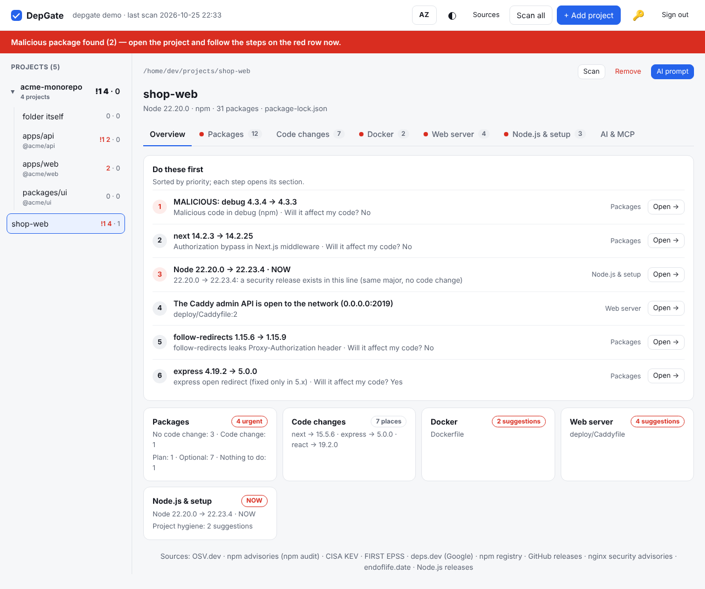

<p align="center">
  
</p>

<h1 align="center">DepGate</h1>

<p align="center">
  <b>Your npm dependencies, triaged in one screen: what to update now, what can wait, whether it breaks your code — and exactly where.</b><br>
  Local web UI · runs in Docker · zero dependencies · English &amp; Azerbaijani
</p>

<p align="center">
  <a href="https://github.com/Ali7Zeynalli/depgate/actions/workflows/ci.yml"></a>
  <a href="https://github.com/Ali7Zeynalli/depgate/releases"></a>
  <a href="https://goreportcard.com/report/github.com/Ali7Zeynalli/depgate"></a>
  <a href="LICENSE"></a>
  
</p>

<p align="center"><a href="#quick-start">Quick start</a> · <a href="#features">Features</a> · <a href="#mcp">MCP</a> · <a href="#what-it-checks">What it checks</a> · <a href="#data-sources">Data sources</a> · <a href="#docker">Docker</a> · <a href="README.az.md">Azərbaycan dilində</a></p>

---

`npm audit` tells you *something* is vulnerable. DepGate tells you **what to do about it**:

| For every package | DepGate answers |
|---|---|
| ① **Do I need to update?** | **NOW** for malware and critical/high CVEs (weighted by CISA KEV + EPSS) · *soon* · *plan* · *optional* · *not needed* |
| ② **Will it affect my code?** | **No** — patch/minor, one command · **Maybe** — peer/engines conflicts · **Yes** — a breaking release |
| 📍 **Where in my code?** | Every place that must change — `file:line`, why, what to write instead — plus the official codemod |
| 🎯 **Which version?** | The *safest minimum*: the lowest clean version in your current major, not "latest", which may break you |
| 🔗 **It's transitive — now what?** | Relock if the parent's range already allows the fix, otherwise upgrade the direct parent, otherwise a ready `overrides` block |
| 🧩 **Does it move alone?** | `react` + `react-dom`, `next` + `eslint-config-next`, `@nestjs/*`, `@angular/*`… are shown as one group with one command |
| 🕵️ **Is the new version itself safe?** | Skips versions younger than 3 days and flags new install scripts, lost npm provenance, a changed publisher or repository |
| 🤖 **Can my AI agent do it?** | One ready prompt with every change, an `AGENTS.md` block so the agent writes code for *your* versions — or the agent asks DepGate itself over **MCP**, per project, and checks every package before installing it |

It also checks your Node.js runtime and your Dockerfiles and compose files. Everything runs on your machine and DepGate **never changes your files** — it only shows and suggests.

Each project (and each folder) opens on **Overview**: the few things to do first, sorted by priority, and one card per section. The rest is split into sections, so you only see one thing at a time: **Packages** (one compact row per package — click it for the full answer), **Code changes**, **Docker**, **Node.js & setup** and **AI & MCP**.




## Why now

2026 has been the worst year yet for the npm supply chain:

- **March** — the [Axios package](https://unit42.paloaltonetworks.com/axios-supply-chain-attack/), with over 100 million weekly downloads, was compromised by a North Korea-linked actor and shipped a backdoor.
- **May** — the [Mini Shai-Hulud worm](https://braindetox.kr/en/posts/npm_supply_chain_attack_2026.html) replaced 314 legitimate packages with 637 malicious versions in 22 minutes.
- **June** — [57 packages](https://threatcluster.io/cluster/large-scale-supply-chain-attack-targets-npm-packages-via-bin-4588b024) were hijacked through `binding.gyp`, running code on `npm install`.
- **October** — Node.js shipped [10 security fixes](https://securityonline.info/nodejs-security-release-october-2026/) including CVE-2026-111497, a Brotli remote code execution bug in the runtime itself.

Dependabot opens a PR per package; `npm audit fix --force` may jump majors and break your build. DepGate gives you the full picture across all your projects — runtime included — and the exact, smallest safe step for each one.

## Quick start

```bash
go install github.com/Ali7Zeynalli/depgate@latest
depgate            # opens http://127.0.0.1:7777 — set a password, then "+ Add project"
```

or with Docker:

```bash
git clone https://github.com/Ali7Zeynalli/depgate.git && cd depgate
DEPGATE_UID=$(id -u) DEPGATE_GID=$(id -g) docker compose up -d
```

Open `http://127.0.0.1:7777`, choose a password and add projects from anywhere in your home folder.

Connect your AI agent to a project (see [MCP](#mcp)) — easiest with the **Connection command** button in the **AI & MCP** section, which fills in the path and token; by hand:

```bash
cd ~/projects/shop && claude mcp add --transport http depgate -s local \
  "http://127.0.0.1:7777/mcp?project=$PWD" --header "Authorization: Bearer $(depgate --print-token)"
# token in Docker:  docker exec depgate depgate --print-token
```

If DepGate saves you a bad afternoon, a ⭐ helps other developers find it.

<a id="features"></a>
## Features

### 📍 What changes in your code

"Code change: yes" is not enough, so DepGate shows **where**. When an update crosses a documented breaking release, it reads your project's own files (locally, nothing is sent) and lists every place that needs a change: `file:line`, the line itself, why it breaks and what to write instead, things to check by hand, and the official codemod when one exists. If places are found, the card moves to *Do now — code change*.

Covered with exact places: **Next.js 15 and 16, React 18 and 19, TanStack Query 5, ESLint 9, Tailwind CSS 4, Express 5, NestJS 11, Zod 4, Prisma 7, React Router 6 and 7**. Angular, Nx, Storybook and Expo get their official upgrade tools. For any other package with a major update, DepGate shows the *Breaking changes* sections of the GitHub releases between your version and the target.

When a newer major exists beyond the suggested target, a collapsed **"If you move to the new major"** section shows what that move would touch, so you can plan it without changing today's answer. Matching is text based: review each place, then run the build and tests.


### 🗂 Folders and monorepos

Add a folder — a monorepo or a folder of projects — and it appears as one entry in the sidebar with its projects nested below, named by their path. Click the folder name for an overview of all of them: a project table, totals, then every finding by category. A finding that appears in several projects is shown once, with each project that has it and the `cd … && …` command for each one. **Scan folder** and **Remove folder** act on all of them.


### 🤖 AI prompt and AI rules

- **AI prompt** (folder or project) writes one task for Claude Code, Cursor or any agent: every package to change, where it is, which version and why, the advisories, the code impact, the places in your code, the codemods, rules (malware first, safest minimum version, build and tests after each project) and what to report back.
- **AI rules** builds an `AGENTS.md` / `CLAUDE.md` / `.cursor/rules` block from the versions in your lockfile. Models are trained on older versions, so they write `getServerSideProps` in a Next.js 16 app or `.eslintrc` for ESLint 9; the block lists your exact stack, version-specific rules with links to the official upgrade guides (Next.js, React, Tailwind, ESLint, Express, NestJS, Prisma, Zod, TanStack Query, React Router, TypeScript, Node.js), and built-in or maintained replacements for outdated packages (`request`, `moment`, `node-fetch`, `dotenv`, `rimraf`, …).

Both can be copied or downloaded as `.md`; DepGate does not write them into your project.


<a id="mcp"></a>
### 🔌 AI agents over MCP

`depgate mcp` is a [Model Context Protocol](https://modelcontextprotocol.io) server, so Claude Code, Cursor, VS Code or any MCP client can ask DepGate itself instead of you pasting prompts. It works **per project**: tools act on the project the agent runs in (or the one set with `--project`), and any call can name another one — a path, a package name or a folder inside a monorepo such as `apps/api`.

```bash
# over HTTP to the running DepGate (recommended: same data as the UI, works with Docker)
cd ~/projects/shop && claude mcp add --transport http depgate -s local \
  "http://127.0.0.1:7777/mcp?project=$PWD" --header "Authorization: Bearer $(depgate --print-token)"
# token in Docker:  docker exec depgate depgate --print-token
# or over stdio, the agent starts DepGate itself
cd ~/projects/shop && claude mcp add depgate -s local -- depgate mcp --project "$PWD"
```

**Where the agent's data comes from**

| Connection | Data | Use it when |
|---|---|---|
| **HTTP** — `http://127.0.0.1:7777/mcp?project=…` with the DepGate token | the running DepGate server: the same projects and reports as the UI | always recommended; DepGate runs in Docker; the agent runs on another machine (start DepGate with `--addr 0.0.0.0 --allow-host <name>`, keep the token secret) |
| **stdio** — `depgate mcp --project …` | the local data folder (`~/.config/depgate`), or the container's with `docker exec -i depgate depgate mcp` | no server running; CI; offline |

If stdio finds no local projects while a DepGate server is running, it says so and points to the HTTP connection. `/mcp` accepts only the `Authorization: Bearer` token (no browser session), rejects foreign `Origin` headers and only reads folders under DepGate's roots.

The **Connection command** button (section **AI & MCP**) of every project and folder shows these commands with the path filled in, plus the JSON for Cursor and other clients.

| Tool | What the agent gets |
|---|---|
| `project_status` | scan time, Node.js, counts, what to do now, update-together groups, Docker issues |
| `get_findings` | the findings with target version, why, code impact and the exact command |
| `get_fix_plan` | the whole ordered task (also for every project of a monorepo) |
| `get_code_changes` | for one package: `file:line` places to change, codemod, checks, release notes |
| `get_ai_rules` | the exact stack and version rules for writing code |
| `check_package` | **before every install**: is `name@version` safe — vulnerabilities, malware, removed or brand-new versions, install scripts, provenance, Node and peer fit — and which version to use instead |
| `get_docker_issues` | Dockerfile, compose and image findings with file, line, why and the line to use |
| `scan_project` | rescan after changes and confirm |
| `list_projects` | every project DepGate knows |

The server shares DepGate's data folder (same projects and reports as the UI), scans a project on demand when it has no report yet, and never adds projects or changes files. Text from advisories and release notes is quoted as data so it cannot pose as instructions.


### 🧩 Update together

Some packages are released in lockstep: `react` + `react-dom` (+ matching `@types/react`), `next` + `eslint-config-next`, the core `@nestjs/*` packages, `@angular/*`, Vue, Storybook, Nx, Prisma, typescript-eslint, Tiptap. When one of them needs a new version, or their versions have drifted apart, DepGate shows one card with every member, its target and a single command. Packages versioned on their own (for example `@nestjs/config`) stay out.

### 🐳 Docker: security, Compose standard, images

Dockerfiles and compose files in the project and its repo root get three kinds of checks, each finding with file, line, service and the line to use instead (secret values are never shown):

- **Security** (25 rules): running as root, `latest` tags, secrets in `ENV`/`ARG`/`environment`, `npm install` instead of `npm ci`, `curl | sh`, a missing `.dockerignore` (so `.env` can end up in the image), `privileged`, the Docker socket mounted into a container, databases published on all interfaces, host network or PID, unconfined seccomp/AppArmor, and more.
- **Compose Specification:** unknown or misspelled keys (`enviroment` → `environment`), volumes and networks used but not declared, `depends_on` pointing at a missing service, `condition: service_healthy` on a service without a healthcheck, missing `env_file` and build folders, the obsolete `version:` key, legacy `links` — plus production basics that are missing: healthchecks, restart policies, memory limits.
- **Images** (from [endoflife.date](https://endoflife.date)): end-of-life release lines (`redis:6.2`, `postgres:12`, `python:3.8`), lines that end within four months, pinned versions behind the newest patch (`postgres:15.2` → `15.14`), and end-of-life OS variants (`node:18-buster`, `…-alpine3.16`) — for postgres, redis, nginx, python, mysql, mariadb, mongo, php, golang, ruby, rabbitmq, elasticsearch, alpine, debian, ubuntu and more. Node.js images are covered by the Node.js card.

DepGate does not pull images, so it cannot list the CVEs of the system packages *inside* an image; use an image scanner such as Trivy for that. An end-of-life base image or OS is the strongest sign that those CVEs will never be fixed.


### 🌐 Web server: nginx and Caddy

When a project has an nginx config (`nginx.conf`, files under `nginx/`, `conf.d/`, `sites-*/`, `*.conf.template`) or a `Caddyfile`, a **Web server** section appears. It reads the configs (a few folders deep, skipping `node_modules`, build output and other workspaces) and the nginx / Caddy images in your Dockerfiles and compose files:

- **Known vulnerabilities of your version.** nginx: the image tag (`nginx:1.25.3-alpine`, `nginx:1.27`, `nginxinc/nginx-unprivileged`) is matched against [nginx's own security advisories](https://nginx.org/en/security_advisories.html), "Not vulnerable" lines included, and DepGate suggests the lowest version that fixes all of them. Caddy: the version is looked up in OSV.dev (Go vulndb, `github.com/caddyserver/caddy/v2`), and a Caddy line behind the latest release is flagged. Floating tags (`stable`, `latest`, `2`) are not checked.
- **nginx config:** SSLv3 / TLS 1.0 / 1.1, weak ciphers (RC4, 3DES, MD5, NULL, EXPORT), `autoindex on`, `alias` path traversal (off-by-slash), `add_header` in a location that silently drops the server's headers, `$uri` in headers and redirects (CRLF injection), `proxy_set_header Host $http_host`, `proxy_pass` to a user-controlled target (SSRF), HTTPS without HSTS, missing `X-Content-Type-Options` / frame protection / `Referrer-Policy`, `server_tokens` not off. Includes of snippet files are followed, so headers kept in a snippet count.
- **Caddyfile:** the admin API listening beyond localhost, `file_server browse`, `protocols tls1.0/1.1`, `tls_insecure_skip_verify` to upstreams, `tls internal` on a public domain, `debug`, and public sites without HSTS, `nosniff`, `Referrer-Policy` or `-Server`. Snippets (`import`) are expanded; an import DepGate cannot see silences the header checks instead of guessing.

The rules follow [gixy](https://github.com/yandex/gixy) (nginx misconfiguration checks), the [Mozilla SSL Configuration](https://ssl-config.mozilla.org/) guidance, [OWASP Secure Headers](https://owasp.org/www-project-secure-headers/), and the nginx and Caddy documentation. They are text checks on your files: a header your application sends itself is not visible to them.


<a id="what-it-checks"></a>
## What it checks

- **Lockfiles:** `package-lock.json` (v1–v3), `pnpm-lock.yaml` (v5–v9), `yarn.lock` (v1 and Berry), `bun.lock`, workspaces included. Transitive packages are checked. Without a lockfile it reads `node_modules`, and otherwise falls back to a clearly marked approximate mode.
- **Vulnerabilities and malware:** OSV.dev and the npm advisory endpoint (the data behind `npm audit`), merged without duplicates; prerelease versions are matched too, which `npm audit` skips.
- **Removed versions:** a locked version that npm no longer serves (a clean install will fail; npm takes malicious versions down); a package replaced by a `0.0.1-security` placeholder is reported as malware.
- **Priority (0–100):** severity plus [CISA KEV](https://www.cisa.gov/known-exploited-vulnerabilities-catalog) and [EPSS](https://www.first.org/epss/).
- **Safest minimum target:** the lowest clean version in the same major line, skipping versions younger than the cooldown.
- **Transitive fixes:** relock when the parent's range already allows the fix, otherwise upgrade the direct parent, otherwise an `overrides` / `resolutions` block.
- **Code impact:** semver distance, the target's `engines.node` and `peerDependencies`, and the places in your code that a breaking release touches.
- **Supply-chain signals on the target version:** new install scripts, lost npm provenance, a different publisher, a changed repository URL.
- **Node.js runtime:** Dockerfile, `.nvmrc`, `.node-version`, `.tool-versions`, `engines`, GitHub Actions; security releases, end-of-life dates and the CVEs that affect your exact version.
- **Docker:** Dockerfile and compose security (see above).
- **Web server:** nginx and Caddy configs, and the known vulnerabilities of the nginx / Caddy version you run (see above).
- **Project hygiene:** lockfile committed, install scripts disabled, release cooldown configured, consistent Node.js version.

<a id="data-sources"></a>
## Data sources

Every decision is based on public, free sources. The **Sources** button lists them, what each one is used for, and how many requests each one answered in the last scan (or whether it failed). The same list is linked under every project.

| Source | Used for |
|---|---|
| [OSV.dev](https://osv.dev) | vulnerabilities (CVE/GHSA) and malicious packages — includes the GitHub Advisory Database and OpenSSF Malicious Packages; also the vulnerabilities of your Caddy version (Go vulndb) |
| [npm advisories](https://docs.npmjs.com/cli/commands/npm-audit) | the source of `npm audit`: the GitHub Advisory Database directly, malware advisories included — catches records OSV has not imported yet |
| [CISA KEV](https://www.cisa.gov/known-exploited-vulnerabilities-catalog) | vulnerabilities exploited in real attacks (raises priority) |
| [FIRST EPSS](https://www.first.org/epss/) | probability of exploitation in the next 30 days (feeds priority) |
| [deps.dev](https://deps.dev) | every version of a package and its publish date (safest target, cooldown) |
| [npm registry](https://www.npmjs.com) | the target version's `engines`, peer dependencies, install scripts, provenance, deprecation; whether a locked version still exists |
| [GitHub releases](https://docs.github.com/en/rest/releases/releases) | breaking-change sections of the releases between your version and the target (major updates); the latest Caddy release |
| [nginx security advisories](https://nginx.org/en/security_advisories.html) | which nginx versions are vulnerable and which fix them |
| [endoflife.date](https://endoflife.date) | support dates and latest patch releases of the Docker images you use |
| [Node.js releases](https://nodejs.org/en/about/previous-releases) + [Node.js Security WG](https://github.com/nodejs/security-wg) | Node.js versions, security releases, end-of-life dates, and the CVEs that affect your exact version |

Read locally, never sent: `package.json`, the lockfile, your source files (for *What changes in your code*), Dockerfiles and compose files, nginx configs and Caddyfiles, `.nvmrc` / `.node-version` / `engines` / CI files, `.npmrc`, `.dockerignore`.

**Accuracy.** `TestCompareNpmAudit` scans a project with known-vulnerable dependencies and checks that every advisory `npm audit` reports is also in DepGate's report (71 of 71 at the time of writing). It runs weekly in GitHub Actions (`accuracy` workflow), or locally: `DEPGATE_LIVE=1 go test -run TestCompareNpmAudit -v ./internal/scan`.


## Usage

### Web UI (default)

```bash
depgate
```

Opens `http://127.0.0.1:7777`. The dashboard is bilingual (English / Azerbaijani): it follows your browser language and the **AZ / EN** button switches instantly, no rescan needed. Click **+ Add project**, browse your folders (folders with a `package.json` are marked as projects) and add one — or a whole folder: every project below it, monorepo workspaces included, is added and scanned in the background.

DepGate remembers your projects and their last reports (`~/.config/depgate`), so next time everything is already there. Per project: **Scan**, **Remove**, **AI prompt**, and the sections Overview · Packages · Code changes · Docker · Node.js & setup · AI & MCP (the open section is kept in the address, so a reload or a shared link opens the same one); per folder the same for all of its projects; **Scan all** in the header. Running `depgate` inside a project folder (or `depgate ~/projects`) adds it right away.

The browser can only see folders under the allowed roots (your home directory by default; `--root` to change).


<a id="docker"></a>
### Docker

```bash
DEPGATE_UID=$(id -u) DEPGATE_GID=$(id -g) docker compose up -d
```

or without compose:

```bash
docker run -d --name depgate -p 127.0.0.1:7777:7777 --user "$(id -u):$(id -g)" \
  -e HOME=$HOME -e DEPGATE_ROOTS=$HOME \
  -v $HOME:$HOME:ro -v depgate-data:/data \
  --read-only --tmpfs /tmp --cap-drop ALL ghcr.io/ali7zeynalli/depgate:latest
```

- Your **home folder is mounted read-only at the same path**, so the UI shows your real paths and you can add projects from anywhere in it — nothing to move. DepGate never writes there.
- The container runs **as your user** (`DEPGATE_UID`/`DEPGATE_GID`, default 1000) so it can read your files; a one-shot `depgate-init` step gives the data volume to that user first (this also repairs volumes created by older versions).
- The project list, reports and password hash live in the **`depgate-data` Docker volume** (survives restarts and upgrades). Prefer sharing them with a native `depgate`? Swap the volume for `${HOME}/.config/depgate:/data` (see the comment in `docker-compose.yml`).
- The port is published on `127.0.0.1` only. `DEPGATE_PASSWORD=…` sets the password up front; `DEPGATE_GITHUB_TOKEN=…` raises the GitHub limit for release notes.

### One-shot modes

```bash
depgate --json > report.json # scan, print JSON (schema depgate/report@1), exit
depgate --view report.json   # open a saved report in the UI
depgate --ci --fail-on high  # exit 1 on high/critical vulnerabilities or malware
depgate --push URL --token T # scan and POST the report
depgate --offline            # no network, cache only
depgate mcp --project DIR    # MCP server for AI agents (stdio)
```

| Flag | What it does | Default |
|---|---|---|
| `--port` | UI port (next free port if busy) | 7777 |
| `--addr` | Listen address | 127.0.0.1 (0.0.0.0 in Docker) |
| `--root` | Folder the UI may browse (repeatable; `DEPGATE_ROOTS`) | home directory |
| `--data` | Project list, reports, password hash (`DEPGATE_DATA`) | `~/.config/depgate` |
| `--allow-host` | Extra allowed `Host` name, e.g. a LAN name (repeatable) | — |
| `--print-token` | Print the API/MCP token (Docker: `docker exec depgate depgate --print-token`) | — |
| `--reset-password` | Forget the UI password; the next visit asks for a new one | — |
| `--no-auth` | Disable the password (127.0.0.1 only; not recommended) | off |
| `--no-open` | Don't open the browser | opens |
| `--offline` | Never touch the network | off |
| `--depth` | Project discovery depth | 3 |
| `--cooldown` | Skip versions younger than N days as targets | 3 |
| `--json`, `--view`, `--ci`, `--fail-on`, `--push`, `--token` | One-shot modes above | — |

| Environment variable | What it does |
|---|---|
| `DEPGATE_PASSWORD` | Set the UI password up front (min. 8 characters) |
| `DEPGATE_GITHUB_TOKEN` | GitHub token (no scopes needed) for release notes beyond 60 requests an hour; `GITHUB_TOKEN` works too |
| `DEPGATE_TOKEN` | API token for scripts (`Authorization: Bearer …`) |
| `DEPGATE_ROOTS`, `DEPGATE_DATA` | Same as `--root` and `--data` |
| `DEPGATE_PUSH_TOKEN` | Token for `--push` |
| `DEPGATE_PROJECT` | Default project for `depgate mcp` (same as `--project`) |
| `DEPGATE_LANG=az` | Terminal messages in Azerbaijani |

## Privacy

Only public package data leaves your machine: package names and versions (OSV, npm, deps.dev), CVE IDs (EPSS), the GitHub repository names of packages that get a major update (release notes), and the product names of your Docker images (endoflife.date). Source code, file paths, project names and `.env` files never do. Responses are cached in `~/.cache/depgate/`.

The UI binds to `127.0.0.1` (in Docker: published on the host's `127.0.0.1`), is protected by your password, checks the `Host` header and sends a strict Content Security Policy. Folder browsing is limited to the allowed roots, and DepGate only ever reads your projects.

## Why a password?

DepGate runs a small web server on `127.0.0.1:7777`. Without protection, anything that can reach that address could use it:

- **other websites you visit** — a malicious page or ad can send requests to `127.0.0.1` from your browser (CSRF, DNS rebinding) and try to read your folders, project names and reports;
- **other programs and users on the same machine** — a localhost port is open to all of them;
- **your network** — if the Docker port were ever published on `0.0.0.0`, everyone on your Wi-Fi could open the UI.

DepGate can browse your folders and shows where your projects are weak — exactly what an attacker wants — so the UI is behind a password:

- **first visit:** you choose a password (min. 8 characters) — no tokens, no links to copy;
- **after that:** a normal sign-in page with *remember me* (30 days); **Sign out** and **Change password** are in the header (changing it signs out every other browser);
- **forgot it?** `depgate --reset-password` (Docker: `docker exec depgate depgate --reset-password`), then set a new one;
- **Docker / automation:** `DEPGATE_PASSWORD=…` sets it up front; scripts can call the API with `Authorization: Bearer <token>` (the token is in `~/.config/depgate/token`; in Docker set your own with `DEPGATE_TOKEN`).

The password is stored only as a PBKDF2-SHA256 hash (600 000 iterations, random salt); repeated wrong attempts are slowed down. On top of that DepGate checks the `Host` header, requires a custom header on every API call and sends a strict Content Security Policy.

## Development

```bash
go test ./...
go vet ./...
go run . ./testdata/lockfiles/npm-v3
```

Standard library only, no third-party Go modules. See [CONTRIBUTING.md](CONTRIBUTING.md). Security reports: [SECURITY.md](SECURITY.md).

## License

[MIT](LICENSE)
