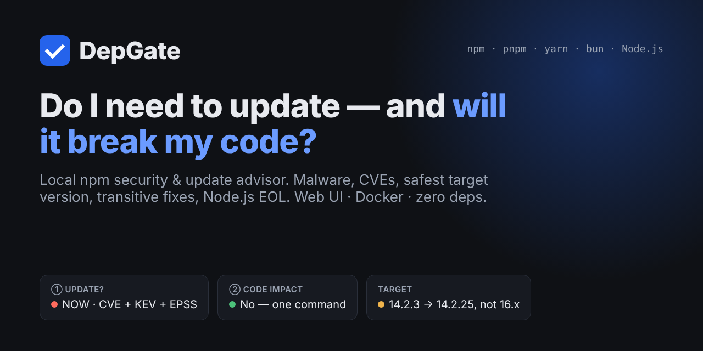
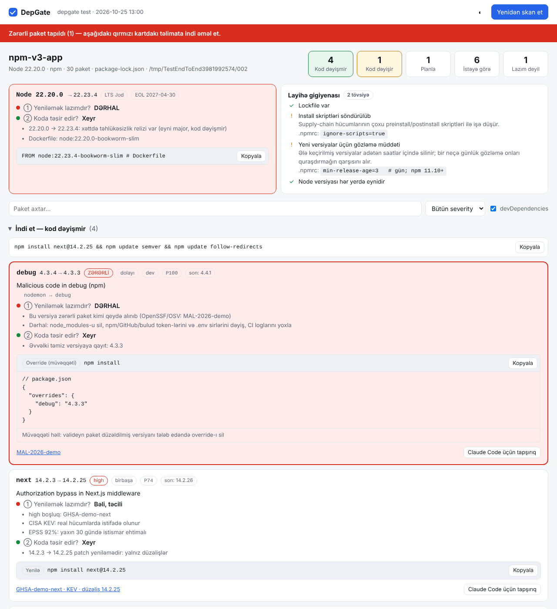
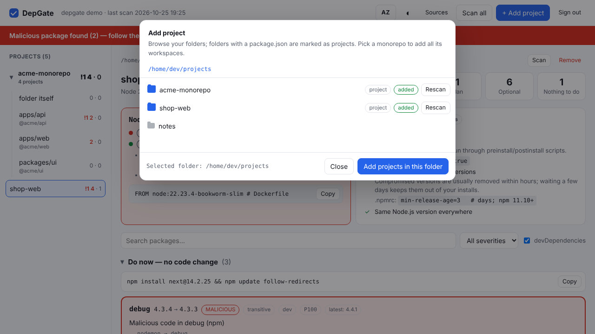

<p align="center">
  
</p>

<h1 align="center">DepGate</h1>

<p align="center">
  <b>Your npm dependencies, triaged in one screen: what to update now, what can wait, and whether the update breaks your code.</b><br>
  Local web UI · runs in Docker · zero dependencies · English &amp; Azerbaijani
</p>

<p align="center">
  <a href="https://github.com/Ali7Zeynalli/depgate/actions/workflows/ci.yml"></a>
  <a href="https://github.com/Ali7Zeynalli/depgate/releases"></a>
  <a href="https://goreportcard.com/report/github.com/Ali7Zeynalli/depgate"></a>
  <a href="LICENSE"></a>
  
</p>

<p align="center"><a href="#quick-start">Quick start</a> · <a href="#why-now">Why now</a> · <a href="#what-it-checks">What it checks</a> · <a href="#docker">Docker</a> · <a href="README.az.md">Azərbaycan dilində</a></p>

---

`npm audit` tells you *something* is vulnerable. DepGate tells you **what to do about it**:

| For every package | DepGate answers |
|---|---|
| ① **Do I need to update?** | **NOW** for malware and critical/high CVEs (weighted by CISA KEV + EPSS) · *soon* · *plan* · *optional* · *not needed* |
| ② **Will it affect my code?** | **No** — patch/minor, one command · **Maybe** — peer/engines conflicts · **Yes** — major bump, with the migration guide |
| 🎯 **Which version?** | The *safest minimum*: the lowest clean version in your current major — not "latest", which may break you |
| 🔗 **It's transitive — now what?** | Relock if the parent's range already allows the fix, otherwise upgrade the direct parent, otherwise a ready `overrides` block |
| 🕵️ **Is the new version itself safe?** | Skips versions younger than 3 days and flags new install scripts, lost npm provenance, a changed publisher or repository |

Everything runs on your machine. Only package names, versions and CVE IDs ever leave it — never your code.



## Why now

2026 has been the worst year yet for the npm supply chain:

- **March** — the [Axios package](https://unit42.paloaltonetworks.com/axios-supply-chain-attack/), with over 100 million weekly downloads, was compromised by a North Korea-linked actor and shipped a backdoor.
- **May** — the [Mini Shai-Hulud worm](https://braindetox.kr/en/posts/npm_supply_chain_attack_2026.html) replaced 314 legitimate packages with 637 malicious versions in 22 minutes.
- **June** — [57 packages](https://threatcluster.io/cluster/large-scale-supply-chain-attack-targets-npm-packages-via-bin-4588b024) were hijacked through `binding.gyp`, running code on `npm install`.
- **October** — Node.js shipped [10 security fixes](https://securityonline.info/nodejs-security-release-october-2026/) including CVE-2026-111497, a Brotli remote code execution bug in the runtime itself.

Dependabot opens a PR per package; `npm audit fix --force` may jump majors and break your build. DepGate gives you the full picture across all your projects — runtime included — and the exact, smallest safe step for each one.

## Quick start

```bash
go install github.com/Ali7Zeynalli/depgate@latest
depgate            # opens http://127.0.0.1:7777 — set a password, then "+ Add project"
```

or with Docker (clone the repo first):

```bash
mkdir -p ~/.config/depgate
DEPGATE_UID=$(id -u) DEPGATE_GID=$(id -g) docker compose up -d
```

Open `http://127.0.0.1:7777`, choose a password, add projects from anywhere in your home folder.

If DepGate saves you a bad afternoon, a ⭐ helps other developers find it.

## Install

```bash
go install github.com/Ali7Zeynalli/depgate@latest
```

Or download a prebuilt binary (Linux, macOS, Windows; amd64, arm64) from [Releases](https://github.com/Ali7Zeynalli/depgate/releases). Every release ships SHA-256 checksums and build provenance attestations.

## Usage

### Web UI (default)

```bash
depgate
```

Opens `http://127.0.0.1:7777`. The dashboard is bilingual (English / Azerbaijani): it follows your browser language and the **AZ / EN** button switches instantly, no rescan needed. Click **+ Add project**, browse your folders (folders with a `package.json` are marked as projects) and add one — or a whole folder: every project below it, monorepo workspaces included, is added and scanned in the background.

DepGate remembers your projects and their last reports (`~/.config/depgate`), so next time everything is already there. Per project: **Scan**, **Remove**; for all: **Scan all**. Running `depgate` inside a project folder (or `depgate ~/projects`) adds it right away.

The browser can only see folders under the allowed roots (your home directory by default; `--root` to change).



<a id="docker"></a>
### Docker

```bash
mkdir -p ~/.config/depgate
DEPGATE_UID=$(id -u) DEPGATE_GID=$(id -g) docker compose up -d
```

or without compose:

```bash
mkdir -p ~/.config/depgate
docker run -d --name depgate -p 127.0.0.1:7777:7777 --user "$(id -u):$(id -g)" \
  -e HOME=$HOME -e DEPGATE_ROOTS=$HOME \
  -v $HOME:$HOME:ro -v $HOME/.config/depgate:/data \
  --read-only --tmpfs /tmp --cap-drop ALL ghcr.io/ali7zeynalli/depgate:latest
```

- Your **home folder is mounted read-only at the same path**, so the UI shows your real paths and you can add projects from anywhere in it — nothing to move. DepGate never writes there.
- The container runs **as your user** (`DEPGATE_UID`/`DEPGATE_GID`, default 1000) so it can read your files.
- The project list, reports and password hash live in `~/.config/depgate` — **the same folder a native `depgate` uses**, so both see the same projects.
- The port is published on `127.0.0.1` only. `DEPGATE_PASSWORD=…` sets the password up front instead of in the browser.

### One-shot modes

```bash
depgate --json > report.json # scan, print JSON (schema depgate/report@1), exit
depgate --view report.json   # open a saved report in the UI
depgate --ci --fail-on high  # exit 1 on high/critical vulnerabilities or malware
depgate --push URL --token T # scan and POST the report
depgate --offline            # no network, cache only
```

| Flag | What it does | Default |
|---|---|---|
| `--port` | UI port (next free port if busy) | 7777 |
| `--addr` | Listen address | 127.0.0.1 (0.0.0.0 in Docker) |
| `--root` | Folder the UI may browse (repeatable; `DEPGATE_ROOTS`) | home directory |
| `--data` | Project list, reports, token (`DEPGATE_DATA`) | `~/.config/depgate` |
| `--allow-host` | Extra allowed `Host` name, e.g. a LAN name (repeatable) | — |
| `--reset-password` | Forget the UI password; the next visit asks for a new one | — |
| `--no-auth` | Disable the password (127.0.0.1 only; not recommended) | off |
| `--no-open` | Don't open the browser | opens |
| `--offline` | Never touch the network | off |
| `--depth` | Project discovery depth | 3 |
| `--cooldown` | Skip versions younger than N days as targets | 3 |
| `--json`, `--view`, `--ci`, `--fail-on`, `--push`, `--token` | One-shot modes above | — |

Terminal messages are in English; set `DEPGATE_LANG=az` for Azerbaijani.

<a id="what-it-checks"></a>
## What it checks

- **Lockfiles:** `package-lock.json` (v1–v3), `pnpm-lock.yaml` (v5–v9), `yarn.lock` (v1 and Berry), `bun.lock`, workspaces included. Transitive packages are checked. Without a lockfile it reads `node_modules`, and otherwise falls back to a clearly marked approximate mode.
- **Vulnerabilities and malware:** [OSV.dev](https://osv.dev), including GitHub Security Advisories and OpenSSF Malicious Packages.
- **Priority (0–100):** severity plus [CISA KEV](https://www.cisa.gov/known-exploited-vulnerabilities-catalog) and [EPSS](https://www.first.org/epss/).
- **Safest minimum target:** the lowest clean version in the same major line, skipping versions younger than the cooldown.
- **Transitive fixes:** relock when the parent's range already allows the fix, otherwise upgrade the direct parent, otherwise an `overrides` / `resolutions` block.
- **Code impact:** semver distance, the target's `engines.node` and `peerDependencies` against your project.
- **Supply-chain signals on the target version:** new install scripts, lost npm provenance, a different publisher, a changed repository URL.
- **Node.js runtime:** Dockerfile, `.nvmrc`, `.node-version`, `.tool-versions`, `engines`, GitHub Actions; security releases and end-of-life dates.
- **Project hygiene:** lockfile committed, install scripts disabled, release cooldown configured, consistent Node.js version.

## Privacy

Only package names and versions (OSV, deps.dev, npm registry) and CVE IDs (EPSS) leave your machine. Source code, file paths, project names and `.env` files never do. Responses are cached in `~/.cache/depgate/`.

The UI binds to `127.0.0.1` (in Docker: published on the host's `127.0.0.1`), is protected by your password, checks the `Host` header and sends a strict Content Security Policy. Folder browsing is limited to the allowed roots, and DepGate only ever reads your projects.

## Why a password?

DepGate runs a small web server on `127.0.0.1:7777`. Without protection, anything that can reach that address could use it:

- **other websites you visit** — a malicious page or ad can send requests to `127.0.0.1` from your browser (CSRF, DNS rebinding) and try to read your folders, project names and reports;
- **other programs and users on the same machine** — a localhost port is open to all of them;
- **your network** — if the Docker port were ever published on `0.0.0.0`, everyone on your Wi-Fi could open the UI.

DepGate can browse your folders and shows where your projects are weak — exactly what an attacker wants — so the UI is behind a password:

- **first visit:** you choose a password (min. 8 characters) — no tokens, no links to copy;
- **after that:** a normal sign-in page with *remember me* (30 days); **Sign out** and **Change password** are in the header (changing it signs out every other browser);
- **forgot it?** `depgate --reset-password` (Docker: `docker exec depgate depgate --reset-password`), then set a new one;
- **Docker / automation:** `DEPGATE_PASSWORD=…` sets it up front; scripts can call the API with `Authorization: Bearer <token>` (the token is in `~/.config/depgate/token` or set with `DEPGATE_TOKEN`).

The password is stored only as a PBKDF2-SHA256 hash (600 000 iterations, random salt); repeated wrong attempts are slowed down. On top of that DepGate checks the `Host` header, requires a custom header on every API call and sends a strict Content Security Policy.

## Development

```bash
go test ./...
go vet ./...
go run . ./testdata/lockfiles/npm-v3
```

See [CONTRIBUTING.md](CONTRIBUTING.md). Security reports: [SECURITY.md](SECURITY.md).

## License

[MIT](LICENSE)
