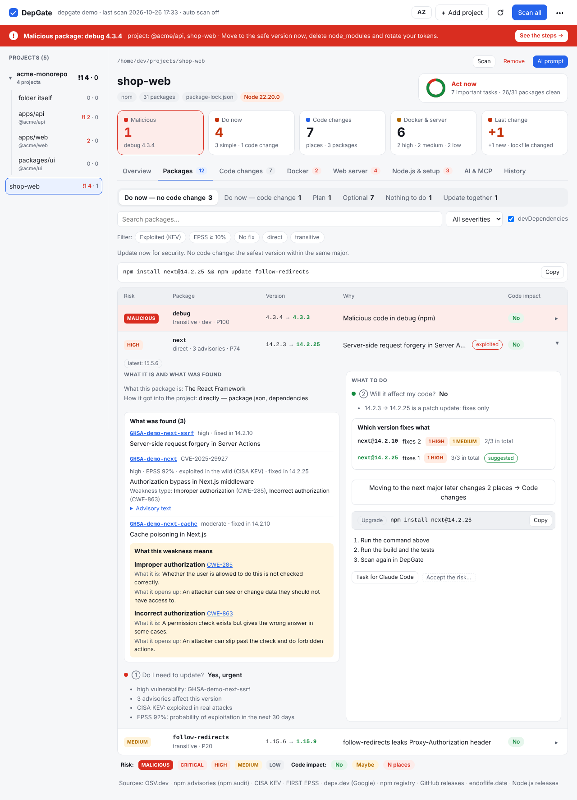
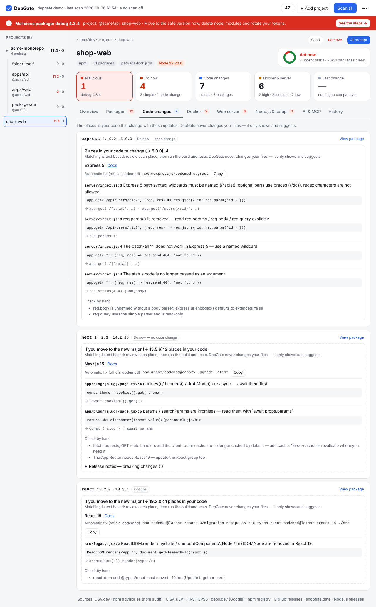
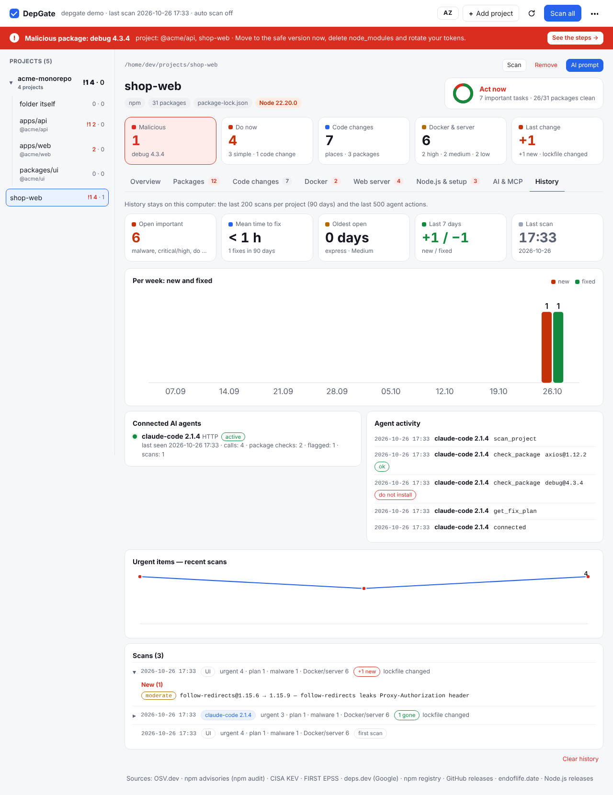
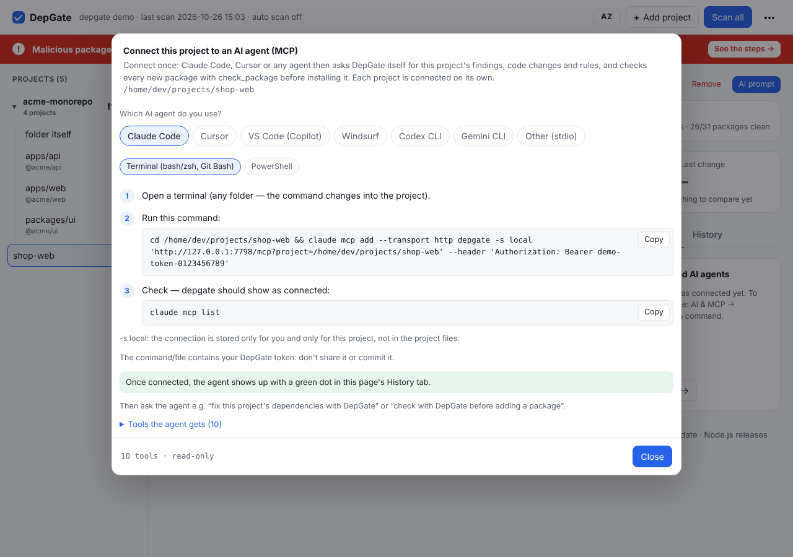

<p align="center">
  
</p>

<h1 align="center">DepGate</h1>

<p align="center">
  <b>Your npm dependencies in one screen: what to update now, whether it breaks your code — and exactly where.</b><br>
  Linux · macOS · Windows · Docker or a single binary · zero dependencies · English &amp; Azerbaijani
</p>

<p align="center">
  <a href="https://github.com/Ali7Zeynalli/depgate/actions/workflows/ci.yml"></a>
  <a href="https://github.com/Ali7Zeynalli/depgate/releases"></a>
  <a href="LICENSE"></a>
  
  · <a href="README.az.md">Azərbaycan dilində</a>
</p>

---

`npm audit` tells you *something* is vulnerable. DepGate tells you **what to do** — for every package:

- ① **Do I need to update?** now · soon · plan · optional · not needed — malware and exploited CVEs first
- ② **Will it affect my code?** no · maybe · yes — and if yes, **every place to change** (`file:line`) plus the codemod
- 🎯 **To which version?** the *safest minimum*, not "latest"
- 🤖 **Can my AI agent do it?** a ready prompt, version rules and an MCP server — Claude Code, Cursor, VS Code, Windsurf, Codex, Gemini
- 📈 **What changed?** projects are rescanned on their own and every scan is compared with the one before

It also checks Dockerfiles, docker-compose, nginx, Caddy and your Node.js runtime. It runs on your computer and **never changes your files** — it only shows and suggests.


## Install

**Docker** — Linux, macOS, Windows; nothing to configure:

```bash
git clone https://github.com/Ali7Zeynalli/depgate.git && cd depgate
docker compose up -d
```

**Single binary** — from [Releases](https://github.com/Ali7Zeynalli/depgate/releases), run `./depgate` (Windows: `depgate.exe`). **Go** — `go install github.com/Ali7Zeynalli/depgate@latest`.

Then open `http://127.0.0.1:7777`, choose a password and **+ Add project** (a project or a whole folder).

<details>
<summary>Docker on Windows, updates, binary notes</summary>

| Docker started from | DepGate sees |
|---|---|
| Linux / macOS terminal | your home at its real path |
| Windows PowerShell or cmd | `C:\Users\you` as `/host` |
| Windows Git Bash | `C:\Users\you` as `/c/Users/you` |
| Windows WSL | your WSL home — projects on the Windows side? start it from PowerShell |

- Your home is mounted read-only; the container runs as its owner and drops root. Data lives in the `depgate-data` volume.
- Update: `git pull && docker compose up -d` (it always fetches the newest image). DepGate shows a notice at the top when a new version is out, with the command.
- macOS binary, first run: `xattr -d com.apple.quarantine ./depgate`. Windows SmartScreen: *More info → Run anyway*.
- Verify downloads: `checksums.txt` and `gh attestation verify <file> -R Ali7Zeynalli/depgate`.
</details>

## What you get

| Section | What it shows |
|---|---|
| **Overview** | the state at a glance (malware, do now, code changes, Docker & server, last change) and the first steps in order, with the command where there is one; indicators: time to fix, oldest open finding, this week |
| **Packages** | one row per package, risk first: what it is, what was found, the weakness in plain words (CWE), the safest version, **which version fixes what**, the command and numbered steps; filters for exploited (KEV), EPSS, no fix, direct / transitive; malware, removed versions, packages that must update together; **accept a risk** with a reason until a date (it comes back by itself) |
| **Code changes** | `file:line` places for Next.js, React, Express, NestJS, Prisma, Zod, Tailwind, ESLint, TanStack Query, React Router; codemods; breaking changes from release notes |
| **Docker** | Dockerfiles and compose files anywhere in the project or repository (`docker/`, `deploy/`, `infra/`…, and the files a compose file builds from or includes): 37 rules for security mistakes and Compose Specification errors, end-of-life and outdated images |
| **Web server** | nginx / Caddy: known vulnerabilities of your version, TLS, headers, path traversal, exposed admin API |
| **Node.js & setup** | runtime security releases and end of life; lockfile, install scripts, release cooldown, the same Node.js version everywhere |
| **AI & MCP** | a ready prompt, `AGENTS.md` version rules, the setup for your agent, which agents are connected |
| **History** | while DepGate runs, projects are scanned again automatically (every 12 h by default, changeable in the ⋯ menu); indicators (open important findings, mean time to fix, oldest open finding, new and fixed per week); every scan compared with the one before: what is new, what is gone, whether the lockfile changed or a new advisory appeared; who ran it (UI, command line, automatic scan or an AI agent) and what each agent checked over MCP |

Folders and monorepos get one merged page with a table of their projects (trend, oldest open finding, time to fix); a finding in several projects is shown once. The page updates by itself (every 20 s and when you come back to it; ⟳ refreshes at once). On a phone it stacks into one column.

| Packages | Code changes |
|---|---|
|  |  |
| **History** | **AI agent setup** |
|  |  |

## AI agents (MCP)

The agent asks DepGate itself — and checks every package **before** it installs it (`check_package`). The **AI & MCP → Connection command** button shows the setup for your agent — Claude Code, Cursor, VS Code, Windsurf, Codex CLI, Gemini CLI or any stdio client — with path and token filled in:

```bash
# once, for every project (Claude Code tells DepGate which folder it is in)
claude mcp add --transport http depgate -s user http://127.0.0.1:7777/mcp \
  --header "Authorization: Bearer $(depgate --print-token)"
```

Then ask it, or use the ready commands: `/mcp__depgate__fix` (fix the dependencies), `/mcp__depgate__status`, `/mcp__depgate__check` (a package before installing), `/mcp__depgate__docker`, `/mcp__depgate__changes`.

<details>
<summary>Tools, Windows, stdio</summary>

| Tool | What the agent gets |
|---|---|
| `check_package` | is `name@version` safe to install, and which version to use instead |
| `get_fix_plan` | the whole ordered task (also for every project of a monorepo) |
| `get_findings` · `get_code_changes` | findings with target and command · `file:line` places for one package |
| `get_docker_issues` | Docker, compose, image, nginx and Caddy findings |
| `get_ai_rules` · `project_status` · `scan_project` · `list_projects` | version rules · summary · rescan · all projects |
| `get_history` | what changed between recent scans — to confirm a fix worked |

- Windows PowerShell: `claude mcp add --transport http depgate -s user http://127.0.0.1:7777/mcp --header "Authorization: Bearer $(depgate --print-token)"` — Docker on Windows: Windows paths (`C:\Users\you\…`) are understood.
- Only this project: add `?project=<its path>` to the URL and use `-s local` in the project folder.
- Token in Docker: `docker exec depgate depgate --print-token`.
- Without a running server (stdio), also once for every project: `claude mcp add depgate -s user -- depgate mcp` (it uses the folder Claude Code runs in).
- `/mcp` needs the token, rejects foreign origins and reads only allowed folders; advisory text is passed as data, not instructions.
</details>

## Data sources

Public and free: [OSV.dev](https://osv.dev), [npm advisories](https://docs.npmjs.com/cli/commands/npm-audit), [CISA KEV](https://www.cisa.gov/known-exploited-vulnerabilities-catalog), [FIRST EPSS](https://www.first.org/epss/), [deps.dev](https://deps.dev), [npm registry](https://www.npmjs.com), [GitHub releases](https://docs.github.com/en/rest/releases/releases), [nginx advisories](https://nginx.org/en/security_advisories.html), [endoflife.date](https://endoflife.date), [Node.js releases](https://nodejs.org/en/about/previous-releases). **⋯ → Sources** (or the line at the bottom of a project page) shows how each one answered in the last scan.

A weekly test checks that every advisory `npm audit` reports is also in DepGate's report (71 of 71 at the time of writing).

## Command line

```bash
depgate ~/projects            # open the UI and add every project below ~/projects
depgate --ci --fail-on high   # exit 1 on malware, or a high/critical vulnerability in a production dependency
depgate --json > report.json  # scan once, print JSON
depgate --view report.json    # open a saved report
depgate --reset-password      # Docker: docker exec depgate depgate --reset-password
```

Risks you accept in the UI also count for `--ci`. For CI on another machine, download `depgate-accept.json` (**Packages → Risk accepted**) and commit it to the repository root: the UI, `--ci` and your whole team then accept the same risks, each with its reason and end date. Malware can never be accepted.

<details>
<summary>Flags and environment variables</summary>

| Flag · env | What it does | Default |
|---|---|---|
| `--port` | UI port | 7777 |
| `--root` · `DEPGATE_ROOTS` | folders the UI may browse | your home |
| `--data` · `DEPGATE_DATA` | project list, reports, scan history, password hash | `~/.config/depgate` · macOS `~/Library/Application Support/depgate` · Windows `%AppData%\depgate` |
| `--offline` | no network, cache only | off |
| `--cooldown` | skip target versions younger than N days | 3 |
| `--depth` | how deep to look for projects below a folder | 6 |
| `--addr` · `DEPGATE_ADDR` | listen address | `127.0.0.1` (`0.0.0.0` in the container) |
| `--push URL` · `--token` / `DEPGATE_PUSH_TOKEN` | scan once and POST the JSON report to a URL | — |
| `--rescan` · `DEPGATE_RESCAN_HOURS` | scan projects again when the last scan is older than N hours (0 = off; also in the UI) | 12 |
| `DEPGATE_NO_UPDATE_CHECK=1` | don't check GitHub once a day for a newer DepGate | — |
| `--print-token` · `DEPGATE_TOKEN` | API / MCP token | generated |
| `DEPGATE_PASSWORD` | set the password up front | — |
| `DEPGATE_GITHUB_TOKEN` | more GitHub requests for release notes | — |
| `DEPGATE_LANG=az` | terminal messages in Azerbaijani | English |

More: `depgate --help`.
</details>

## Security and privacy

- Only package names, versions, CVE ids, image names and GitHub repository names (for release notes) leave your computer — never code, paths or `.env` files. Reports, history and accepted risks stay in the data folder. Once a day DepGate asks GitHub for the newest release number and shows a notice if there is one.
- Read-only: nothing is written into your projects; in Docker your home is mounted read-only and DepGate runs without root.
- The UI listens on `127.0.0.1` (in Docker the port is published on `127.0.0.1` only) and is password-protected (PBKDF2-SHA256); API calls need a custom header, the `Host` header is checked, a strict CSP is sent.

**Limits:** npm only (npm, pnpm, yarn, bun) · code places are found by text patterns, so review them · no CVE scan inside container images (use Trivy) · it reads the folders of the computer it runs on.

## Development

`go test ./... && go vet ./...` — standard library only. See [CONTRIBUTING.md](CONTRIBUTING.md) and [SECURITY.md](SECURITY.md).

If DepGate saves you a bad afternoon, a ⭐ helps others find it. — [MIT](LICENSE)
